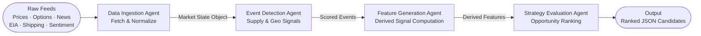
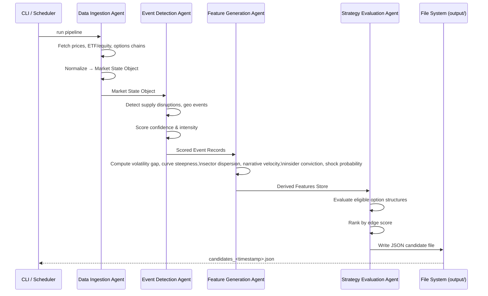

# Energy Options Opportunity Agent — User Guide

> **Version 1.0 · March 2026**
> This guide walks a developer through setting up, configuring, and running the full pipeline end-to-end.

---

## Table of Contents

1. [Overview](#overview)
2. [Prerequisites](#prerequisites)
3. [Setup & Configuration](#setup--configuration)
4. [Running the Pipeline](#running-the-pipeline)
5. [Interpreting the Output](#interpreting-the-output)
6. [Troubleshooting](#troubleshooting)

---

## Overview

The **Energy Options Opportunity Agent** is an autonomous, modular Python pipeline that identifies options trading opportunities driven by oil market instability. It ingests market data, supply signals, news events, and alternative datasets, then surfaces volatility mispricing in oil-related instruments and ranks candidate strategies by a computed **edge score**.

The pipeline is composed of four loosely coupled agents that execute in sequence:



### Agent Responsibilities at a Glance

| Agent | Role | Key Outputs |
|---|---|---|
| **Data Ingestion** | Fetch & normalize raw feeds | Unified market state object, historical store |
| **Event Detection** | Identify supply & geo events | Confidence/intensity-scored event records |
| **Feature Generation** | Compute derived signals | Volatility gaps, curve steepness, shock probability, etc. |
| **Strategy Evaluation** | Rank option structures | Scored candidate list (JSON) |

### In-Scope Instruments (MVP)

| Category | Instruments |
|---|---|
| Crude futures | Brent Crude, WTI (`CL=F`) |
| ETFs | USO, XLE |
| Energy equities | XOM (Exxon), CVX (Chevron) |

### In-Scope Option Structures (MVP)

`long_straddle` · `call_spread` · `put_spread` · `calendar_spread`

> **Advisory only.** The system does not execute trades. All output is for informational and analytical purposes.

---

## Prerequisites

### Runtime Requirements

| Requirement | Minimum version | Notes |
|---|---|---|
| Python | 3.10+ | Tested on 3.11 |
| pip | 23+ | Or use `pipenv` / `poetry` |
| Git | Any recent | For cloning the repository |
| Docker (optional) | 24+ | For containerised deployment |

### Hardware / Infrastructure

The agent is designed for a **lightweight footprint** and runs comfortably on:

- A modern laptop or desktop (4 GB RAM, 10 GB disk minimum)
- A single low-cost cloud VM or container (e.g., a 2-vCPU / 4 GB instance)

### External API Accounts

Sign up for the following free-tier services before configuration. All are free or low-cost.

| Service | Used by | Sign-up URL | Cost |
|---|---|---|---|
| Alpha Vantage | Crude prices (WTI, Brent) | https://www.alphavantage.co | Free |
| Yahoo Finance / `yfinance` | ETF, equity, options data | No key required for basic use | Free |
| Polygon.io | Options chain data (optional upgrade) | https://polygon.io | Free tier |
| EIA Open Data | Inventory & refinery utilization | https://www.eia.gov/opendata/ | Free |
| GDELT Project | News & geopolitical events | No key required | Free |
| NewsAPI | News headlines | https://newsapi.org | Free tier |
| SEC EDGAR | Insider trades | No key required | Free |
| Quiver Quant | Insider activity (enhanced) | https://www.quiverquant.com | Free/Limited |
| MarineTraffic | Tanker flow data | https://www.marinetraffic.com | Free tier |
| VesselFinder | Tanker flow (fallback) | https://www.vesselfinder.com | Free tier |
| Reddit API | Retail sentiment | https://www.reddit.com/prefs/apps | Free |
| Stocktwits API | Retail sentiment | https://api.stocktwits.com | Free |

> **Phase note:** Not all sources are required for an MVP run. See [MVP Phasing](#mvp-phasing-and-enabling-agents) for which sources are needed per phase.

---

## Setup & Configuration

### 1. Clone the Repository

```bash
git clone https://github.com/your-org/energy-options-agent.git
cd energy-options-agent
```

### 2. Create and Activate a Virtual Environment

```bash
python -m venv .venv
source .venv/bin/activate        # macOS / Linux
# .venv\Scripts\activate.bat     # Windows CMD
# .venv\Scripts\Activate.ps1     # Windows PowerShell
```

### 3. Install Dependencies

```bash
pip install --upgrade pip
pip install -r requirements.txt
```

### 4. Configure Environment Variables

Copy the provided template and edit it with your credentials:

```bash
cp .env.example .env
```

Open `.env` in your editor and populate each variable. The full reference table is below.

#### Environment Variable Reference

| Variable | Required | Default | Description |
|---|---|---|---|
| `ALPHA_VANTAGE_API_KEY` | Phase 1+ | — | API key for crude price feeds (WTI, Brent spot/futures) |
| `POLYGON_API_KEY` | Optional | — | Polygon.io key for enhanced options chain data |
| `EIA_API_KEY` | Phase 2+ | — | EIA Open Data API key for inventory and refinery utilization |
| `NEWSAPI_KEY` | Phase 2+ | — | NewsAPI key for headline ingestion |
| `GDELT_ENABLED` | Phase 2+ | `true` | Set `false` to disable GDELT event feed |
| `QUIVER_QUANT_API_KEY` | Phase 3+ | — | Quiver Quant key for insider activity data |
| `MARINE_TRAFFIC_API_KEY` | Phase 3+ | — | MarineTraffic API key for tanker flow data |
| `REDDIT_CLIENT_ID` | Phase 3+ | — | Reddit OAuth app client ID |
| `REDDIT_CLIENT_SECRET` | Phase 3+ | — | Reddit OAuth app client secret |
| `REDDIT_USER_AGENT` | Phase 3+ | `energy-agent/1.0` | Reddit API user-agent string |
| `STOCKTWITS_API_KEY` | Phase 3+ | — | Stocktwits API key for sentiment velocity |
| `OUTPUT_DIR` | All | `./output` | Directory where JSON candidate files are written |
| `HISTORICAL_DATA_DIR` | All | `./data/historical` | Root path for persisted raw and derived data |
| `RETENTION_DAYS` | All | `365` | Days of historical data to retain (6–12 months recommended) |
| `MARKET_DATA_INTERVAL_MINUTES` | All | `5` | Refresh cadence for minute-level market data feeds |
| `LOG_LEVEL` | All | `INFO` | Logging verbosity: `DEBUG`, `INFO`, `WARNING`, `ERROR` |
| `PIPELINE_PHASE` | All | `1` | Active MVP phase (1–4); gates which agents and sources load |
| `MIN_EDGE_SCORE_THRESHOLD` | All | `0.0` | Minimum edge score to include a candidate in output |

> **Tip:** Variables marked **Phase 2+** or **Phase 3+** are ignored (not validated) when `PIPELINE_PHASE` is set to a lower phase number. You do not need to populate them for a Phase 1 run.

#### Minimal `.env` for a Phase 1 Run

```dotenv
ALPHA_VANTAGE_API_KEY=your_alpha_vantage_key_here
OUTPUT_DIR=./output
HISTORICAL_DATA_DIR=./data/historical
PIPELINE_PHASE=1
LOG_LEVEL=INFO
```

### 5. Initialise the Data Directories

```bash
python -m agent init
```

This command creates the `OUTPUT_DIR` and `HISTORICAL_DATA_DIR` folder trees and verifies that all environment variables required by the active `PIPELINE_PHASE` are present.

Expected output:

```
[INFO]  Initialising pipeline (Phase 1)...
[INFO]  Output directory:     ./output
[INFO]  Historical data dir:  ./data/historical
[INFO]  Required env vars:    OK
[INFO]  Initialisation complete.
```

---

## Running the Pipeline

### Pipeline Flow Summary



### Running Once (Ad-Hoc)

Execute the full pipeline for a single evaluation cycle:

```bash
python -m agent run
```

The four agents execute in sequence. On success, a timestamped JSON file is written to `OUTPUT_DIR`:

```
./output/candidates_2026-03-15T14:32:00Z.json
```

### Running with a Custom Output Path

```bash
python -m agent run --output-dir /path/to/custom/output
```

### Running a Specific Phase Only

```bash
python -m agent run --phase 2
```

This overrides `PIPELINE_PHASE` in `.env` for that invocation.

### Running on a Schedule (cron)

For minute-level cadence on market data, add a cron entry:

```bash
crontab -e
```

```cron
# Run the full pipeline every 5 minutes on weekdays during market hours (US Eastern)
*/5 9-17 * * 1-5 /path/to/.venv/bin/python -m agent run >> /var/log/energy-agent.log 2>&1
```

> **EIA and EDGAR feeds** update daily or weekly. The pipeline is designed to tolerate stale or missing data without failure; slower feeds are cached and re-used until a fresh pull is available.

### Running in Docker

```bash
docker build -t energy-options-agent .

docker run --rm \
  --env-file .env \
  -v $(pwd)/output:/app/output \
  -v $(pwd)/data:/app/data \
  energy-options-agent
```

### Running Individual Agents (Advanced)

Each agent can be invoked independently for debugging or incremental updates:

```bash
python -m agent run --agent ingestion      # Data Ingestion Agent only
python -m agent run --agent events         # Event Detection Agent only
python -m agent run --agent features       # Feature Generation Agent only
python -m agent run --agent strategy       # Strategy Evaluation Agent only
```

> When running a single agent, it reads its inputs from the most recent persisted market state or features store in `HISTORICAL_DATA_DIR`.

### MVP Phasing and Enabling Agents

Set `PIPELINE_PHASE` to control which data sources and scoring layers are active:

| Phase | Name | Active Data Sources | Active Signals |
|---|---|---|---|
| **1** | Core Market Signals & Options | Alpha Vantage, yfinance, Yahoo/Polygon options | IV surface, volatility gap, strike distribution |
| **2** | Supply & Event Augmentation | + EIA, GDELT, NewsAPI | + Supply disruption indices, event-driven scoring |
| **3** | Alternative / Contextual Signals | + EDGAR, Quiver, MarineTraffic, Reddit, Stocktwits | + Insider conviction, narrative velocity, tanker flow |
| **4** | High-Fidelity Enhancements | + OPIS (paid), exotic structures | Full signal stack (deferred; not MVP) |

---

## Interpreting the Output

### Output File Location

```
./output/candidates_<ISO8601-UTC-timestamp>.json
```

### Output Schema

Each file contains a JSON array of candidate objects. Every candidate represents a ranked options trading opportunity.

| Field | Type | Description |
|---|---|---|
| `instrument` | `string` | Target instrument (e.g., `"USO"`, `"XLE"`, `"CL=F"`) |
| `structure` | `enum` | Option structure: `long_straddle` · `call_spread` · `put_spread` · `calendar_spread` |
| `expiration` | `integer` (days) | Calendar days from evaluation date to target expiration |
| `edge_score` | `float` [0.0–1.0] | Composite opportunity score; higher = stronger signal confluence |
| `signals` | `object` | Map of contributing signal names to their observed values |
| `generated_at` | ISO 8601 datetime | UTC timestamp of candidate generation |

### Example Candidate

```json
{
  "instrument": "USO",
  "structure": "long_straddle",
  "expiration": 30,
  "edge_score": 0.47,
  "signals": {
    "tanker_disruption_index": "high",
    "volatility_gap": "positive",
    "narrative_velocity": "rising"
  },
  "generated_at": "2026-03-15T14:32:00Z"
}
```

### Understanding the Edge Score

The `edge_score` is a composite float in the range **0.0 – 1.0** where a higher value indicates greater signal confluence in favour of the candidate strategy.

| Edge Score Range | Interpretation |
|---|---|
| 0.75 – 1.00 | Strong confluence — multiple high-confidence signals align |
| 0.50 – 0.74 | Moderate confluence — several signals agree; review contributing signals |
| 0.25 – 0.49 | Weak confluence — limited signal agreement; treat as speculative |
| 0.00 – 0.24 | Minimal confluence — consider filtering out (adjust `MIN_EDGE_SCORE_THRESHOLD`) |

> **Filtering output:** Set `MIN_EDGE_SCORE_THRESHOLD=0.40` in `.env` to suppress low-confidence candidates from the output file.

### Understanding Contributing Signals

The `signals` object provides explainability for every candidate. Each key is a signal computed by the Feature Generation Agent; each value is its observed state at evaluation time.

| Signal Key | Computed From | Possible Values |
|---|---|---|
| `volatility_gap` | Realized IV vs. implied IV | `positive` / `negative` / `neutral` |
| `futures_curve_steepness` | Futures term structure | `steep` / `flat` / `inverted` |
| `sector_dispersion` | Cross-sector price spread | `high` / `moderate` / `low` |
| `insider_conviction_score` | EDGAR / Quiver insider trades | `high` / `moderate` / `low` |
| `narrative_velocity` | Reddit / Stocktwits headline rate | `rising` / `stable` / `falling` |
| `supply_shock_probability` | EIA + event detection scores | `high` / `moderate` / `low` |
| `tanker_disruption_index` | MarineTraffic / VesselFinder flow | `high` / `moderate` / `low` |

### Consuming