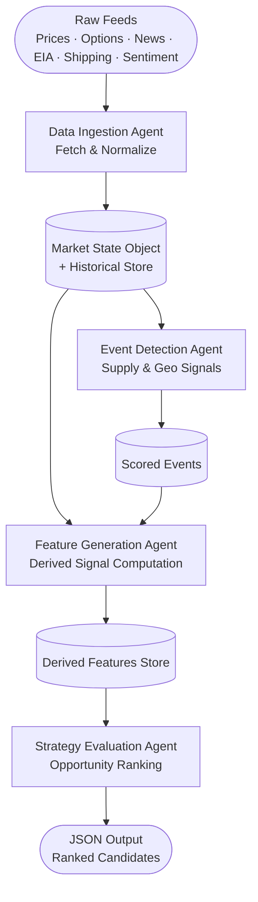

# Energy Options Opportunity Agent — User Guide

> **Version 1.0 · March 2026**
> This guide covers the full pipeline: from initial setup through running all four agents to interpreting ranked strategy candidates.

---

## Table of Contents

1. [Overview](#overview)
2. [Prerequisites](#prerequisites)
3. [Setup & Configuration](#setup--configuration)
4. [Running the Pipeline](#running-the-pipeline)
5. [Interpreting the Output](#interpreting-the-output)
6. [Troubleshooting](#troubleshooting)

---

## Overview

The **Energy Options Opportunity Agent** is a modular, four-agent Python pipeline that identifies options trading opportunities driven by oil market instability. It ingests market data, supply signals, news events, and alternative datasets to produce structured, ranked strategy candidates — each accompanied by an explainable edge score.

### What the pipeline does

| Stage | Agent | Output |
|---|---|---|
| 1 | **Data Ingestion Agent** | Unified market state object (prices, options chains) |
| 2 | **Event Detection Agent** | Scored supply/geopolitical events |
| 3 | **Feature Generation Agent** | Derived signals (volatility gaps, curve steepness, etc.) |
| 4 | **Strategy Evaluation Agent** | Ranked candidate options strategies with edge scores |

### In-scope instruments

| Type | Instruments |
|---|---|
| Crude futures | Brent Crude, WTI (`CL=F`) |
| ETFs | USO, XLE |
| Energy equities | Exxon Mobil (XOM), Chevron (CVX) |

### In-scope option structures (MVP)

- Long straddles
- Call / put spreads
- Calendar spreads

> **Advisory only.** The system produces recommendations; it does **not** execute trades automatically.

### Pipeline data flow



Data flows **unidirectionally** through the four agents. Each agent is independently deployable, so you can update or redeploy one without disrupting the others.

---

## Prerequisites

### System requirements

| Requirement | Minimum |
|---|---|
| Python | 3.10+ |
| OS | Linux, macOS, or Windows (WSL2 recommended) |
| RAM | 2 GB |
| Disk | 10 GB free (for 6–12 months of historical data) |
| Network | Outbound HTTPS to data provider APIs |

### Required accounts and API keys

All data sources are **free or low-cost**. Register for an API key at each provider before proceeding.

| Provider | Purpose | Sign-up URL |
|---|---|---|
| Alpha Vantage | WTI / Brent crude prices | <https://www.alphavantage.co/support/#api-key> |
| Polygon.io | Options chains (IV, volume, strike) | <https://polygon.io/> |
| EIA | Inventory & refinery utilization | <https://www.eia.gov/opendata/> |
| GDELT | Geopolitical / news event stream | No key required (public dataset) |
| NewsAPI | Energy news headlines | <https://newsapi.org/register> |
| SEC EDGAR | Insider transaction filings | No key required (public dataset) |
| Quiver Quant | Insider activity aggregation | <https://www.quiverquant.com/> |
| MarineTraffic | Tanker flow data | <https://www.marinetraffic.com/en/ais-api-services> |

> **yfinance** (Yahoo Finance) and **PRAW** (Reddit) are used via their public/free tiers and do not require a paid API key for MVP usage. Reddit requires a free app registration at <https://www.reddit.com/prefs/apps>.

### Python dependencies

Install the required packages into a virtual environment:

```bash
python -m venv .venv
source .venv/bin/activate          # Windows: .venv\Scripts\activate
pip install --upgrade pip
pip install -r requirements.txt
```

A representative `requirements.txt` includes:

```
yfinance
requests
pandas
numpy
python-dotenv
schedule
```

---

## Setup & Configuration

### 1. Clone the repository

```bash
git clone https://github.com/your-org/energy-options-agent.git
cd energy-options-agent
```

### 2. Create the environment file

Copy the provided template and populate it with your credentials:

```bash
cp .env.example .env
```

Open `.env` in your editor and fill in every value. The full set of environment variables is described in the table below.

### Environment variables reference

| Variable | Required | Description | Example |
|---|---|---|---|
| `ALPHA_VANTAGE_API_KEY` | Yes | Alpha Vantage key for WTI/Brent crude spot/futures | `ABC123XYZ` |
| `POLYGON_API_KEY` | Yes | Polygon.io key for options chains (strike, expiry, IV, volume) | `pk_live_abc...` |
| `EIA_API_KEY` | Yes | EIA Open Data key for inventory & refinery utilization | `a1b2c3d4...` |
| `NEWSAPI_KEY` | Yes | NewsAPI key for energy headline feeds | `1234abcd...` |
| `QUIVER_API_KEY` | Yes | Quiver Quant key for insider conviction data | `qv_live_...` |
| `MARINETRAFFIC_API_KEY` | Yes | MarineTraffic key for tanker flow signals | `mt_abc...` |
| `REDDIT_CLIENT_ID` | Yes | Reddit app client ID for sentiment/narrative velocity | `XyZ123` |
| `REDDIT_CLIENT_SECRET` | Yes | Reddit app client secret | `secret_abc` |
| `REDDIT_USER_AGENT` | Yes | Identifies your app to the Reddit API | `energy-agent/1.0` |
| `OUTPUT_DIR` | No | Directory where JSON output files are written | `./output` |
| `HISTORICAL_DATA_DIR` | No | Root directory for persisted raw and derived data | `./data` |
| `RETENTION_DAYS` | No | Days of historical data to retain (180–365 recommended) | `365` |
| `MARKET_DATA_INTERVAL_SECONDS` | No | Polling cadence for minute-level market data feeds | `60` |
| `LOG_LEVEL` | No | Python logging level (`DEBUG`, `INFO`, `WARNING`, `ERROR`) | `INFO` |

> **Never commit your `.env` file.** It is already listed in `.gitignore` in the provided template.

### 3. Initialise the data store

Run the following command once to create the directory structure and seed the historical data schema:

```bash
python scripts/init_store.py
```

Expected output:

```
[INFO] Creating data directories under ./data ...
[INFO] Historical store initialised. Retention: 365 days.
[INFO] Output directory: ./output
[INFO] Setup complete.
```

---

## Running the Pipeline

### Pipeline execution modes

| Mode | Command | Use case |
|---|---|---|
| **Full pipeline (single run)** | `python run_pipeline.py` | On-demand evaluation |
| **Scheduled (continuous)** | `python run_pipeline.py --schedule` | Production / market-hours operation |
| **Individual agent** | `python run_pipeline.py --agent <name>` | Development / debugging |
| **Dry run (no output written)** | `python run_pipeline.py --dry-run` | Validate config and connectivity |

### Run the full pipeline once

```bash
python run_pipeline.py
```

The four agents execute in sequence:

```
[INFO] [1/4] Data Ingestion Agent    — fetching prices, ETF data, options chains ...
[INFO] [1/4] Data Ingestion Agent    — market state object written to ./data/market_state.json
[INFO] [2/4] Event Detection Agent   — scanning GDELT, NewsAPI for supply events ...
[INFO] [2/4] Event Detection Agent   — 3 events detected and scored
[INFO] [3/4] Feature Generation Agent — computing volatility gaps, curve steepness, signals ...
[INFO] [3/4] Feature Generation Agent — derived features written to ./data/features.json
[INFO] [4/4] Strategy Evaluation Agent — evaluating long_straddle, call_spread, put_spread, calendar_spread ...
[INFO] [4/4] Strategy Evaluation Agent — 5 candidates ranked; output written to ./output/candidates_20260315T143022Z.json
[INFO] Pipeline complete in 47.3 s
```

### Run on a schedule

```bash
python run_pipeline.py --schedule
```

Market data agents poll at the cadence defined by `MARKET_DATA_INTERVAL_SECONDS` (default: 60 s). Slower feeds (EIA, EDGAR) run on their respective daily/weekly schedules automatically.

### Run a single agent

```bash
# Available agent names: ingest | detect | generate | evaluate
python run_pipeline.py --agent ingest
python run_pipeline.py --agent detect
python run_pipeline.py --agent generate
python run_pipeline.py --agent evaluate
```

Each agent reads its required inputs from the shared data store; ensure upstream agents have produced up-to-date output before running a downstream agent in isolation.

### Dry run (connectivity and config check)

```bash
python run_pipeline.py --dry-run
```

This validates all API keys, checks network reachability, and logs what would be fetched — without writing any output files or consuming API quota.

```
[INFO] Dry run mode — no data will be written.
[INFO] Alpha Vantage      OK (WTI, Brent)
[INFO] yfinance           OK (USO, XLE, XOM, CVX)
[INFO] Polygon.io         OK (options chains)
[INFO] EIA API            OK (inventories)
[INFO] NewsAPI            OK
[INFO] GDELT              OK (public, no key)
[INFO] SEC EDGAR          OK (public, no key)
[INFO] Quiver Quant       OK
[INFO] MarineTraffic      OK
[INFO] Reddit (PRAW)      OK
[INFO] All checks passed. Ready to run.
```

### Deployment on a VM or container

For lightweight cloud deployment, run the pipeline as a background process or inside a container. A minimal example using `nohup`:

```bash
nohup python run_pipeline.py --schedule > logs/pipeline.log 2>&1 &
echo "Pipeline PID: $!"
```

Or with Docker (if a `Dockerfile` is provided in the repo):

```bash
docker build -t energy-options-agent:1.0 .
docker run -d \
  --env-file .env \
  -v $(pwd)/data:/app/data \
  -v $(pwd)/output:/app/output \
  energy-options-agent:1.0
```

---

## Interpreting the Output

### Output location

Each pipeline run writes one JSON file to `OUTPUT_DIR` (default `./output`), named with a UTC timestamp:

```
./output/candidates_20260315T143022Z.json
```

### Output schema

Each element in the output array is a **strategy candidate** with the following fields:

| Field | Type | Description |
|---|---|---|
| `instrument` | `string` | Target instrument (`USO`, `XLE`, `CL=F`, `XOM`, `CVX`) |
| `structure` | `enum` | Option structure: `long_straddle` · `call_spread` · `put_spread` · `calendar_spread` |
| `expiration` | `integer` (days) | Target expiration in calendar days from evaluation date |
| `edge_score` | `float` [0.0–1.0] | Composite opportunity score; higher = stronger signal confluence |
| `signals` | `object` | Map of contributing signals and their current state |
| `generated_at` | ISO 8601 datetime | UTC timestamp of candidate generation |

### Example output

```json
[
  {
    "instrument": "USO",
    "structure": "long_straddle",
    "expiration": 30,
    "edge_score": 0.47,
    "signals": {
      "tanker_disruption_index": "high",
      "volatility_gap": "positive",
      "narrative_velocity": "rising"
    },
    "generated_at": "2026-03-15T14:30:22Z"
  },
  {
    "instrument": "XLE",
    "structure": "call_spread",
    "expiration": 21,
    "edge_score": 0.61,
    "signals": {
      "supply_shock_probability": "elevated",
      "volatility_gap": "positive",
      "futures_curve_steepness": "contango_widening",
      "insider_conviction_score": "high"
    },
    "generated_at": "2026-03-15T14:30:22Z"
  }
]
```

### Reading edge scores

| Edge Score Range | Interpretation |
|---|---|
| 0.70 – 1.00 | **Strong confluence** — multiple independent signals aligned; highest priority for review |
| 0.45 – 0.69 | **Moderate confluence** — notable signal overlap; worth evaluating further |
| 0.20 – 0.44 | **Weak signal** — limited confluence; monitor but low priority |
| 0.00 – 0.19 | **Noise level** — insufficient signal alignment; typically filtered from output |

> The edge score is a **heuristic composite**, not a probability of profit. Always apply your own risk management before placing any trade.

### Signal field glossary

| Signal Key | What it measures |
|---|---|
| `volatility_gap` | Difference between realized and implied volatility (`positive` = IV understates realized vol) |
| `futures_curve_steepness` | Slope of the WTI/Brent futures curve (e.g., `contango_widening`, `backwardation`) |
| `sector_dispersion` | Cross-sector correlation divergence among energy equities |
| `insider_conviction_score` | Aggregated insider buy/sell activity from EDGAR/Quiver Quant |
| `narrative_velocity` | Rate of acceleration in energy-related headlines and social mentions |
| `supply_shock_probability` | Modelled probability of a near-term supply disruption |
| `tanker_disruption_index` | Shipping flow anomalies at key tanker chokepoints |

### Visualising output

The JSON output is compatible with any JSON-capable dashboard. To load candidates into **thinkorswim**, import `candidates_*.json` via the platform's script or watchlist import function per the thinkorswim documentation. You can also inspect output directly:

```bash
# Pretty-print the latest output file
cat $(ls -t output/candidates_*.json | head -1) | python -m json.tool

# Filter candidates with edge_score >= 0.45
python -c "
import json, glob
f = sorted(glob.glob('output/candidates_*.json'))[-1]
data = json.load(open(f))
strong = [c for c in data if c['edge_score'] >= 0.45]
print(json.dumps(strong, indent=2))
"
```

---

## Troubleshooting

### Common issues and resolutions

| Symptom | Likely cause | Resolution |
|---|---|---|
| `KeyError: 'ALPHA_VANTAGE_API_KEY'` | Missing `.env` key | Confirm the variable is set in `.env` and the file is in the project root |
| `HTTP 401` from any data provider | Invalid or expired API key | Regenerate the key on the provider's dashboard and update `.env` |
| `HTTP 429 Too Many Requests` | API rate limit exceeded | Increase `MARKET_DATA_INTERVAL_SECONDS`; check provider