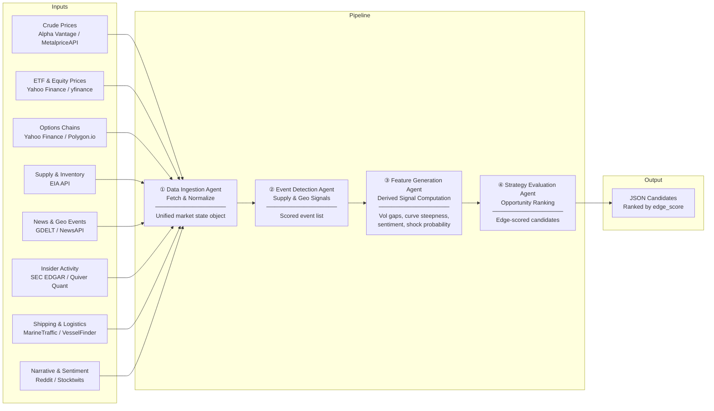

# Energy Options Opportunity Agent — User Guide

> **Version 1.0 · March 2026**
> This guide walks a developer through installing, configuring, and running the full four-agent pipeline end-to-end.

---

## Table of Contents

1. [Overview](#overview)
2. [Prerequisites](#prerequisites)
3. [Setup & Configuration](#setup--configuration)
4. [Running the Pipeline](#running-the-pipeline)
5. [Interpreting the Output](#interpreting-the-output)
6. [Troubleshooting](#troubleshooting)

---

## Overview

The **Energy Options Opportunity Agent** is a modular Python pipeline that identifies options trading opportunities driven by oil market instability. It ingests market data, supply signals, news events, and alternative datasets, then produces a ranked list of candidate options strategies.

The pipeline is composed of four loosely coupled agents that execute in sequence:



### What each agent does

| # | Agent | Role | Key outputs |
|---|-------|------|-------------|
| 1 | **Data Ingestion Agent** | Fetch & normalize all raw feeds | Unified `MarketState` object; historical store |
| 2 | **Event Detection Agent** | Monitor supply & geopolitical signals | Event list with confidence & intensity scores |
| 3 | **Feature Generation Agent** | Compute derived signals | Volatility gaps, curve steepness, sector dispersion, narrative velocity, supply shock probability, insider conviction |
| 4 | **Strategy Evaluation Agent** | Rank option structures | JSON candidate list sorted by `edge_score` |

> **Advisory only.** The system recommends candidates; it does not execute trades automatically.

---

## Prerequisites

### System requirements

| Requirement | Minimum |
|-------------|---------|
| OS | Linux, macOS, or Windows (WSL2 recommended) |
| Python | 3.10 or later |
| RAM | 2 GB available |
| Disk | 10 GB free (6–12 months of historical data) |
| Network | Outbound HTTPS to all data-source APIs |

### Python dependencies

Install the project dependencies from the repository root:

```bash
python -m venv .venv
source .venv/bin/activate          # Windows: .venv\Scripts\activate
pip install --upgrade pip
pip install -r requirements.txt
```

### API accounts

All required data sources are free or have a usable free tier. Obtain credentials before proceeding:

| Source | What you need | Sign-up URL |
|--------|--------------|-------------|
| Alpha Vantage | API key | https://www.alphavantage.co/support/#api-key |
| MetalpriceAPI | API key | https://metalpriceapi.com |
| Polygon.io | API key (free tier) | https://polygon.io |
| EIA | API key | https://www.eia.gov/opendata/ |
| NewsAPI | API key | https://newsapi.org |
| Quiver Quant | API key (free tier) | https://www.quiverquant.com |
| MarineTraffic / VesselFinder | API key or free-tier token | https://www.marinetraffic.com/en/online-services/plans |
| Reddit | OAuth client ID + secret | https://www.reddit.com/prefs/apps |
| GDELT | No key required | — |
| yfinance / SEC EDGAR | No key required | — |

---

## Setup & Configuration

### 1. Clone the repository

```bash
git clone https://github.com/your-org/energy-options-agent.git
cd energy-options-agent
```

### 2. Create the environment file

Copy the provided template and populate your credentials:

```bash
cp .env.example .env
```

Open `.env` in your editor and fill in each value (see the full variable reference below).

### 3. Environment variable reference

All configuration is read from environment variables (loaded via `.env` at startup). No value should be hard-coded in source files.

#### Data source credentials

| Variable | Required | Description |
|----------|----------|-------------|
| `ALPHA_VANTAGE_API_KEY` | Yes | API key for Alpha Vantage crude price feed |
| `METALPRICE_API_KEY` | Yes | API key for MetalpriceAPI (Brent/WTI fallback) |
| `POLYGON_API_KEY` | Yes | Polygon.io API key for options chain data |
| `EIA_API_KEY` | Yes | EIA Open Data API key (inventory & refinery utilization) |
| `NEWSAPI_KEY` | Yes | NewsAPI key for headline ingestion |
| `QUIVER_API_KEY` | Yes | Quiver Quant API key for insider activity |
| `MARINETRAFFIC_API_KEY` | Yes | MarineTraffic or VesselFinder API token for tanker data |
| `REDDIT_CLIENT_ID` | Yes | Reddit OAuth application client ID |
| `REDDIT_CLIENT_SECRET` | Yes | Reddit OAuth application client secret |
| `REDDIT_USER_AGENT` | Yes | Reddit OAuth user-agent string (e.g. `energy-agent/1.0`) |

#### Pipeline behaviour

| Variable | Default | Description |
|----------|---------|-------------|
| `PIPELINE_CADENCE_MINUTES` | `5` | How often (minutes) the market-data refresh cycle runs |
| `EIA_REFRESH_HOURS` | `24` | How often (hours) the EIA supply feed is re-fetched |
| `EDGAR_REFRESH_HOURS` | `24` | How often (hours) the insider-activity feed is re-fetched |
| `DATA_RETENTION_DAYS` | `365` | How many days of raw and derived data to retain |
| `OUTPUT_DIR` | `./output` | Directory where JSON candidate files are written |
| `LOG_LEVEL` | `INFO` | Logging verbosity: `DEBUG`, `INFO`, `WARNING`, `ERROR` |

#### Instruments & strategy scope

| Variable | Default | Description |
|----------|---------|-------------|
| `INSTRUMENTS` | `USO,XLE,XOM,CVX,CL=F,BZ=F` | Comma-separated list of instruments to monitor |
| `OPTION_STRUCTURES` | `long_straddle,call_spread,put_spread,calendar_spread` | Comma-separated list of eligible option structures |
| `MIN_EDGE_SCORE` | `0.20` | Candidates below this threshold are excluded from output |
| `MAX_EXPIRATION_DAYS` | `90` | Maximum target expiration (calendar days) considered |

#### Example `.env`

```dotenv
# Data source credentials
ALPHA_VANTAGE_API_KEY=YOUR_AV_KEY_HERE
METALPRICE_API_KEY=YOUR_MP_KEY_HERE
POLYGON_API_KEY=YOUR_POLYGON_KEY_HERE
EIA_API_KEY=YOUR_EIA_KEY_HERE
NEWSAPI_KEY=YOUR_NEWSAPI_KEY_HERE
QUIVER_API_KEY=YOUR_QUIVER_KEY_HERE
MARINETRAFFIC_API_KEY=YOUR_MT_KEY_HERE
REDDIT_CLIENT_ID=YOUR_REDDIT_CLIENT_ID
REDDIT_CLIENT_SECRET=YOUR_REDDIT_CLIENT_SECRET
REDDIT_USER_AGENT=energy-agent/1.0

# Pipeline behaviour
PIPELINE_CADENCE_MINUTES=5
EIA_REFRESH_HOURS=24
EDGAR_REFRESH_HOURS=24
DATA_RETENTION_DAYS=365
OUTPUT_DIR=./output
LOG_LEVEL=INFO

# Instruments & strategy scope
INSTRUMENTS=USO,XLE,XOM,CVX,CL=F,BZ=F
OPTION_STRUCTURES=long_straddle,call_spread,put_spread,calendar_spread
MIN_EDGE_SCORE=0.20
MAX_EXPIRATION_DAYS=90
```

### 4. Initialize the data store

Run the initialization script once to create the local historical database and output directories:

```bash
python -m agent.cli init
```

Expected output:

```
[INFO] Creating output directory: ./output
[INFO] Initializing historical data store (retention: 365 days)
[INFO] Data store initialized at ./data/market_history.db
[INFO] Initialization complete.
```

---

## Running the Pipeline

### Pipeline execution modes

| Mode | Command | Use case |
|------|---------|----------|
| **Single run** | `python -m agent.cli run` | Execute all four agents once and exit |
| **Continuous loop** | `python -m agent.cli run --loop` | Repeat on the cadence set by `PIPELINE_CADENCE_MINUTES` |
| **Single agent** | `python -m agent.cli run --agent <name>` | Debug or re-run one agent in isolation |
| **Dry run** | `python -m agent.cli run --dry-run` | Validate config and connectivity without writing output |

### Single run

Execute one full pass through all four agents:

```bash
python -m agent.cli run
```

The pipeline proceeds through each stage and writes results to `OUTPUT_DIR`:

```
[INFO] ── Stage 1/4: Data Ingestion Agent ──────────────────────
[INFO] Fetching crude prices          (Alpha Vantage / MetalpriceAPI)
[INFO] Fetching ETF & equity prices   (yfinance)
[INFO] Fetching options chains        (Yahoo Finance / Polygon.io)
[INFO] MarketState object built. Instruments: 6  |  Chains loaded: 6
[INFO] ── Stage 2/4: Event Detection Agent ─────────────────────
[INFO] Scanning GDELT / NewsAPI for energy disruption signals
[INFO] Scanning MarineTraffic for tanker chokepoint events
[INFO] Events detected: 3  (confidence scored)
[INFO] ── Stage 3/4: Feature Generation Agent ──────────────────
[INFO] Computing volatility gaps (realized vs. implied)
[INFO] Computing futures curve steepness
[INFO] Computing sector dispersion
[INFO] Computing insider conviction scores
[INFO] Computing narrative velocity / headline acceleration
[INFO] Computing supply shock probability
[INFO] Feature store updated.
[INFO] ── Stage 4/4: Strategy Evaluation Agent ─────────────────
[INFO] Evaluating long_straddle, call_spread, put_spread, calendar_spread
[INFO] Candidates generated: 11  |  Above MIN_EDGE_SCORE (0.20): 7
[INFO] Output written → ./output/candidates_20260315T143201Z.json
[INFO] Pipeline complete.
```

### Continuous loop

Run the pipeline on a recurring schedule (cadence controlled by `PIPELINE_CADENCE_MINUTES`):

```bash
python -m agent.cli run --loop
```

Interrupt with `Ctrl+C`. The loop completes the current cycle before exiting cleanly.

### Running a single agent

Useful when iterating on one component without re-fetching all data:

```bash
# Re-run only the Feature Generation Agent against the existing MarketState
python -m agent.cli run --agent feature_generation

# Re-run only the Strategy Evaluation Agent
python -m agent.cli run --agent strategy_evaluation
```

Valid `--agent` values: `data_ingestion`, `event_detection`, `feature_generation`, `strategy_evaluation`.

### Dry run

Validate your configuration and API connectivity without producing output files:

```bash
python -m agent.cli run --dry-run
```

```
[INFO] Dry run mode — no output will be written.
[INFO] Checking API connectivity...
[OK]   Alpha Vantage
[OK]   yfinance
[OK]   Polygon.io
[OK]   EIA API
[OK]   NewsAPI
[OK]   GDELT (no key required)
[OK]   Quiver Quant
[OK]   MarineTraffic
[OK]   Reddit OAuth
[INFO] All connectivity checks passed.
```

### Running as a scheduled job

For production-like operation on a server or VM, use `cron` (Linux/macOS) instead of `--loop`:

```bash
# Edit crontab
crontab -e
```

Add the following line to run every 5 minutes:

```cron
*/5 * * * * /path/to/.venv/bin/python -m agent.cli run >> /var/log/energy-agent.log 2>&1
```

Or use a `systemd` timer for more robust process management — see `deploy/systemd/` in the repository for a ready-made unit file.

---

## Interpreting the Output

### Output file location and naming

Each pipeline run writes one JSON file to `OUTPUT_DIR`:

```
./output/candidates_<ISO8601_UTC_timestamp>.json
```

Example: `candidates_20260315T143201Z.json`

### Output schema

Each file contains a JSON array of candidate objects. Every candidate has the following fields:

| Field | Type | Description |
|-------|------|-------------|
| `instrument` | `string` | Target instrument, e.g. `USO`, `XLE`, `CL=F` |
| `structure` | `string` enum | `long_straddle` \| `call_spread` \| `put_spread` \| `calendar_spread` |
| `expiration` | `integer` | Target expiration in calendar days from the evaluation date |
| `edge_score` | `float` [0.0–1.0] | Composite opportunity score; **higher = stronger signal confluence** |
| `signals` | `object` | Map of contributing signals and their qualitative values |
| `generated_at` | `string` ISO 8601 | UTC timestamp of candidate generation |

### Example output

```json
[
  {
    "instrument": "USO",
    "structure": "long_straddle",
    "expiration": 30,
    "edge_score": 0.47,
    "signals": {
      "tanker_disruption_index": "high",
      "volatility_gap": "positive",
      "narrative_velocity": "rising"
    },
    "generated_at": "2026-03-15T14:32:01Z"
  },
  {
    "instrument": "XLE",
    "structure": "call_spread",
    "expiration": 21,
    "edge_score": 0.34,
    "signals": {
      "supply_shock_probability": "elevated",
      "volatility_gap": "positive",
      "sector_dispersion": "widening"
    },
    "generated_at": "2026-03-15T14:32:01Z"
  }
]
```

### Reading the edge score

The `edge_score` is a composite float between `0.0` and `1.0` derived from the confluence of all active signals. Use the following bands as a starting reference:

| Score range | Suggested interpretation |
|-------------|--------------------------|
|