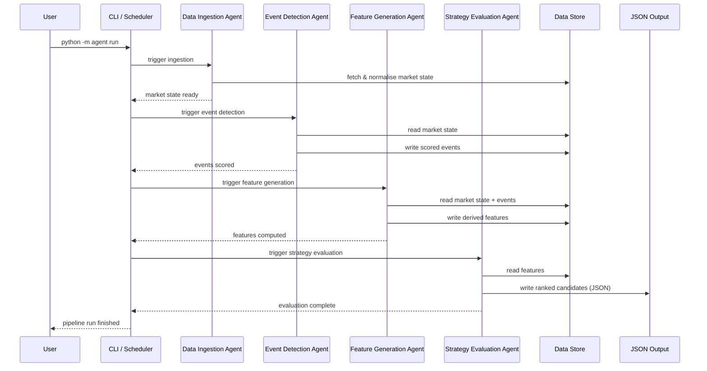

# Energy Options Opportunity Agent — User Guide

> **Version 1.0 · March 2026**
> This guide walks you through configuring, running, and interpreting results from the full Energy Options Opportunity Agent pipeline. It assumes you are comfortable with Python 3 and command-line tools but are new to this project.

---

## Table of Contents

1. [Overview](#overview)
2. [Prerequisites](#prerequisites)
3. [Setup & Configuration](#setup--configuration)
4. [Running the Pipeline](#running-the-pipeline)
5. [Interpreting the Output](#interpreting-the-output)
6. [Troubleshooting](#troubleshooting)

---

## Overview

The **Energy Options Opportunity Agent** is a modular, autonomous Python pipeline that identifies options trading opportunities driven by oil market instability. It processes market data, supply signals, geopolitical news, and alternative datasets to produce **structured, ranked candidate options strategies** — all without automated trade execution.

### What the pipeline does

```mermaid
flowchart LR
    subgraph Ingestion ["① Data Ingestion Agent"]
        A1[Crude Prices\nWTI · Brent]
        A2[ETF / Equity Prices\nUSO · XLE · XOM · CVX]
        A3[Options Chains\nIV · Strike · Expiry]
    end

    subgraph Event ["② Event Detection Agent"]
        B1[News & Geo Feeds\nGDELT · NewsAPI]
        B2[Supply / Inventory\nEIA API]
        B3[Shipping / Logistics\nMarineTraffic]
        B4[Confidence &\nIntensity Scores]
    end

    subgraph Feature ["③ Feature Generation Agent"]
        C1[Volatility Gap\nRealised vs Implied]
        C2[Futures Curve Steepness]
        C3[Sector Dispersion]
        C4[Insider Conviction]
        C5[Narrative Velocity]
        C6[Supply Shock Probability]
    end

    subgraph Strategy ["④ Strategy Evaluation Agent"]
        D1[Evaluate Option Structures]
        D2[Compute Edge Scores]
        D3[Ranked Candidates + Signals]
    end

    Ingestion -->|Market State Object| Event
    Event -->|Scored Events| Feature
    Feature -->|Derived Features Store| Strategy
    Strategy -->|JSON Output| E[Dashboard /\nthinkorswim]
```



Data flows **unidirectionally** through four loosely coupled agents. Each agent can be deployed and updated independently.

### In-scope instruments (MVP)

| Category | Instruments |
|---|---|
| Crude Futures | Brent Crude, WTI (`CL=F`) |
| ETFs | USO, XLE |
| Energy Equities | Exxon Mobil (XOM), Chevron (CVX) |

### In-scope option structures (MVP)

| Structure | Enum Value |
|---|---|
| Long Straddle | `long_straddle` |
| Call Spread | `call_spread` |
| Put Spread | `put_spread` |
| Calendar Spread | `calendar_spread` |

> **Out of scope for MVP:** Exotic/multi-legged strategies, regional refined product pricing (OPIS), and automated trade execution.

---

## Prerequisites

### System requirements

| Requirement | Minimum |
|---|---|
| Python | 3.10 or later |
| OS | Linux, macOS, or Windows (WSL2 recommended) |
| RAM | 2 GB |
| Disk | 10 GB free (6–12 months of historical data) |
| Network | Outbound HTTPS to public APIs |

### Required tools

```bash
# Verify Python version
python --version   # must be 3.10+

# Verify pip
pip --version

# Verify git
git --version
```

### API accounts

Sign up for the following free (or free-tier) services before proceeding. All are zero or low cost.

| Service | Used by | Sign-up URL | Cost |
|---|---|---|---|
| Alpha Vantage | Crude prices | https://www.alphavantage.co | Free |
| Yahoo Finance / yfinance | ETF, equity, options data | Python library — no key needed | Free |
| Polygon.io | Options chains (supplement) | https://polygon.io | Free tier |
| EIA API | Inventory & refinery data | https://www.eia.gov/opendata | Free |
| GDELT | News & geopolitical events | No key required | Free |
| NewsAPI | News headlines | https://newsapi.org | Free tier |
| SEC EDGAR | Insider activity | No key required | Free |
| Quiver Quant | Insider activity (supplement) | https://www.quiverquant.com | Free/Limited |
| MarineTraffic | Tanker / shipping data | https://www.marinetraffic.com | Free tier |
| Reddit API (PRAW) | Narrative / sentiment | https://www.reddit.com/prefs/apps | Free |
| Stocktwits | Narrative / sentiment | https://api.stocktwits.com | Free |

> **MVP Phase 1 minimum:** You only need Alpha Vantage, yfinance (no key), and optionally Polygon.io to run the core market signals layer. Additional keys unlock Phase 2–3 features.

---

## Setup & Configuration

### 1. Clone the repository

```bash
git clone https://github.com/your-org/energy-options-agent.git
cd energy-options-agent
```

### 2. Create and activate a virtual environment

```bash
python -m venv .venv

# Linux / macOS
source .venv/bin/activate

# Windows (PowerShell)
.venv\Scripts\Activate.ps1
```

### 3. Install dependencies

```bash
pip install --upgrade pip
pip install -r requirements.txt
```

### 4. Configure environment variables

Copy the provided template and populate it with your API keys:

```bash
cp .env.example .env
```

Open `.env` in your editor and fill in the values described in the table below.

#### Full environment variable reference

| Variable | Agent | Required | Default | Description |
|---|---|---|---|---|
| `ALPHA_VANTAGE_API_KEY` | Data Ingestion | Yes (Phase 1) | — | API key for WTI/Brent spot & futures prices |
| `POLYGON_API_KEY` | Data Ingestion | Optional | — | Polygon.io key for supplemental options chain data |
| `EIA_API_KEY` | Event Detection | Phase 2+ | — | EIA Open Data API key for inventory & refinery utilization |
| `NEWS_API_KEY` | Event Detection | Phase 2+ | — | NewsAPI key for energy headline feeds |
| `GDELT_ENABLED` | Event Detection | Phase 2+ | `true` | Set to `false` to disable GDELT fetching |
| `QUIVER_QUANT_API_KEY` | Feature Generation | Phase 3+ | — | Quiver Quant key for insider conviction data |
| `MARINE_TRAFFIC_API_KEY` | Feature Generation | Phase 3+ | — | MarineTraffic key for tanker flow data |
| `REDDIT_CLIENT_ID` | Feature Generation | Phase 3+ | — | Reddit app client ID (PRAW) |
| `REDDIT_CLIENT_SECRET` | Feature Generation | Phase 3+ | — | Reddit app client secret |
| `REDDIT_USER_AGENT` | Feature Generation | Phase 3+ | `energy-agent/1.0` | Reddit API user-agent string |
| `STOCKTWITS_ENABLED` | Feature Generation | Phase 3+ | `true` | Set to `false` to disable Stocktwits fetching |
| `DATA_RETENTION_DAYS` | All | No | `365` | Days of historical raw and derived data to retain (180–365 recommended) |
| `OUTPUT_DIR` | Strategy Evaluation | No | `./output` | Directory where JSON output files are written |
| `LOG_LEVEL` | All | No | `INFO` | Logging verbosity: `DEBUG`, `INFO`, `WARNING`, `ERROR` |
| `PIPELINE_CADENCE_MINUTES` | All | No | `5` | How often the pipeline polls market data feeds (minutes-level cadence) |
| `HISTORICAL_BOOTSTRAP_DAYS` | Data Ingestion | No | `180` | Days of history to fetch on first run for volatility baseline |

#### Example `.env`

```dotenv
# --- Data Ingestion ---
ALPHA_VANTAGE_API_KEY=YOUR_ALPHA_VANTAGE_KEY
POLYGON_API_KEY=YOUR_POLYGON_KEY

# --- Event Detection ---
EIA_API_KEY=YOUR_EIA_KEY
NEWS_API_KEY=YOUR_NEWSAPI_KEY
GDELT_ENABLED=true

# --- Feature Generation ---
QUIVER_QUANT_API_KEY=YOUR_QUIVER_KEY
MARINE_TRAFFIC_API_KEY=YOUR_MARINETRAFFIC_KEY
REDDIT_CLIENT_ID=YOUR_REDDIT_CLIENT_ID
REDDIT_CLIENT_SECRET=YOUR_REDDIT_CLIENT_SECRET
REDDIT_USER_AGENT=energy-agent/1.0
STOCKTWITS_ENABLED=true

# --- Pipeline ---
DATA_RETENTION_DAYS=365
OUTPUT_DIR=./output
LOG_LEVEL=INFO
PIPELINE_CADENCE_MINUTES=5
HISTORICAL_BOOTSTRAP_DAYS=180
```

### 5. Initialise the data store

On first run, bootstrap the historical dataset used for volatility and curve calculations:

```bash
python -m agent bootstrap
```

Expected output:

```
[INFO] Bootstrapping 180 days of historical data...
[INFO] Fetching WTI prices from Alpha Vantage...
[INFO] Fetching Brent prices from Alpha Vantage...
[INFO] Fetching USO, XLE, XOM, CVX from yfinance...
[INFO] Fetching options chains from yfinance / Polygon...
[INFO] Bootstrap complete. Records written to ./data/historical/
```

> **First-run note:** Bootstrap may take several minutes depending on API rate limits. Alpha Vantage free-tier requests are throttled to 5 per minute.

---

## Running the Pipeline

### Pipeline execution flow



### Run once (manual / ad-hoc)

```bash
python -m agent run
```

### Run a specific agent only

Each agent can be invoked independently without disrupting the others:

```bash
# Data Ingestion only
python -m agent run --agent ingestion

# Event Detection only
python -m agent run --agent events

# Feature Generation only
python -m agent run --agent features

# Strategy Evaluation only
python -m agent run --agent strategy
```

### Run on a schedule (continuous mode)

Use continuous mode to poll at the cadence defined by `PIPELINE_CADENCE_MINUTES`:

```bash
python -m agent run --continuous
```

Alternatively, register a cron job (Linux / macOS):

```bash
# Run every 5 minutes during market hours (Mon–Fri, 09:00–17:00 ET)
*/5 9-17 * * 1-5 /path/to/.venv/bin/python -m agent run >> /var/log/energy-agent.log 2>&1
```

### Run with Docker (optional)

```bash
# Build the image
docker build -t energy-options-agent:latest .

# Run once
docker run --env-file .env -v $(pwd)/output:/app/output energy-options-agent:latest

# Run continuously
docker run --env-file .env -v $(pwd)/output:/app/output energy-options-agent:latest --continuous
```

### Useful CLI flags

| Flag | Description |
|---|---|
| `--agent <name>` | Run a single agent: `ingestion`, `events`, `features`, `strategy` |
| `--continuous` | Poll indefinitely at `PIPELINE_CADENCE_MINUTES` interval |
| `--dry-run` | Execute all logic but skip writing output to disk |
| `--log-level DEBUG` | Override `LOG_LEVEL` for this run only |
| `--output-dir <path>` | Override `OUTPUT_DIR` for this run only |
| `--phase <1|2|3>` | Restrict pipeline to features available in the specified MVP phase |

---

## Interpreting the Output

### Output location

After each run, ranked strategy candidates are written to:

```
./output/candidates_<ISO8601_timestamp>.json
```

A symlink `./output/latest.json` always points to the most recent file.

### Output schema

Each entry in the output array represents one candidate options opportunity:

| Field | Type | Description |
|---|---|---|
| `instrument` | `string` | Target instrument, e.g. `USO`, `XLE`, `CL=F` |
| `structure` | `enum` | Option structure: `long_straddle` · `call_spread` · `put_spread` · `calendar_spread` |
| `expiration` | `integer` (days) | Target expiration in calendar days from evaluation date |
| `edge_score` | `float [0.0–1.0]` | Composite opportunity score — higher = stronger signal confluence |
| `signals` | `object` | Map of contributing signals and their current reading |
| `generated_at` | ISO 8601 datetime | UTC timestamp of candidate generation |

### Example output

```json
[
  {
    "instrument": "USO",
    "structure": "long_straddle",
    "expiration": 30,
    "edge_score": 0.47,
    "signals": {
      "tanker_disruption_index": "high",
      "volatility_gap": "positive",
      "narrative_velocity": "rising"
    },
    "generated_at": "2026-03-15T14:32:00Z"
  },
  {
    "instrument": "XLE",
    "structure": "call_spread",
    "expiration": 21,
    "edge_score": 0.31,
    "signals": {
      "volatility_gap": "positive",
      "supply_shock_probability": "elevated",
      "sector_dispersion": "widening"
    },
    "generated_at": "2026-03-15T14:32:00Z"
  }
]
```

### Reading the edge score

The `edge_score` is a composite float in the range `[0.0, 1.0]` reflecting signal confluence across all active pipeline layers. Use the following thresholds as a starting guide:

| Edge Score Range | Interpretation |
|---|---|
| `0.70 – 1.00` | Strong signal confluence — high-priority candidate |
| `0.40 – 0.69` | Moderate confluence — worth manual review |
| `0.20 – 0.39` | Weak confluence — monitor for change |
| `0.00 – 0.19` | Negligible signal — low priority |

> **Important:** The edge score is advisory only. The system does not execute trades. Always apply your own risk management before acting on any candidate.

### Signal map reference

The `signals` object contains one or more of the following keys, depending on which pipeline phase is active:

| Signal Key | Phase Available | What it measures |
|---|---|---|
| `volatility_gap` | 1+ | Realized vs. implied volatility divergence |
| `futures_curve_steepness` | 1+ | Contango / backward