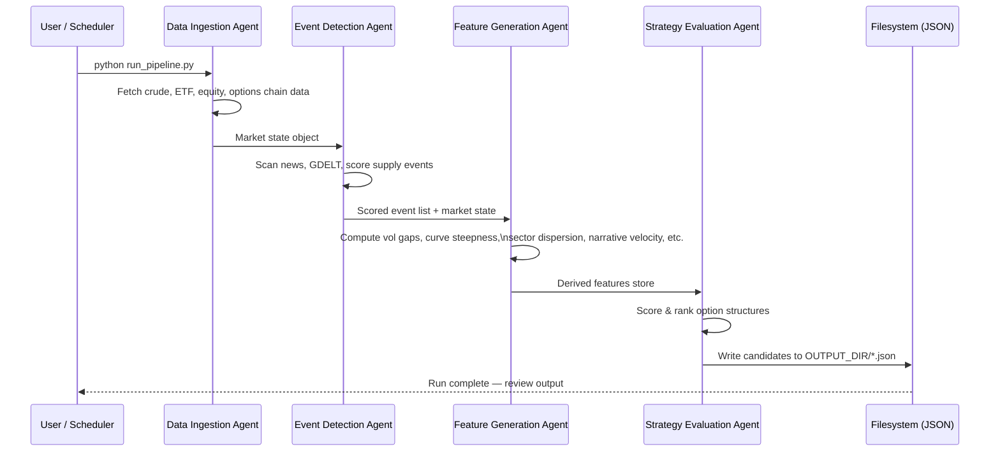

# Energy Options Opportunity Agent — User Guide

> **Version 1.0 · March 2026**
> This guide walks a developer through configuring, running, and interpreting output from the full Energy Options Opportunity Agent pipeline.

---

## Table of Contents

1. [Overview](#overview)
2. [Prerequisites](#prerequisites)
3. [Setup & Configuration](#setup--configuration)
4. [Running the Pipeline](#running-the-pipeline)
5. [Interpreting the Output](#interpreting-the-output)
6. [Troubleshooting](#troubleshooting)

---

## Overview

The **Energy Options Opportunity Agent** is an autonomous, modular Python pipeline that identifies options trading opportunities driven by oil market instability. It ingests market data, supply signals, news events, and alternative datasets, then produces structured, ranked candidate options strategies.

The pipeline is composed of four loosely coupled agents that communicate through a shared **market state object** and a **derived features store**. Data flows strictly in one direction — raw feeds in, ranked opportunities out.

```mermaid
flowchart LR
    subgraph Sources["External Data Sources"]
        S1["Crude Prices\n(Alpha Vantage / MetalpriceAPI)"]
        S2["ETF & Equity Prices\n(yfinance / Yahoo Finance)"]
        S3["Options Chains\n(Yahoo Finance / Polygon.io)"]
        S4["Supply & Inventory\n(EIA API)"]
        S5["News & Geo Events\n(GDELT / NewsAPI)"]
        S6["Insider Activity\n(SEC EDGAR / Quiver Quant)"]
        S7["Shipping & Logistics\n(MarineTraffic / VesselFinder)"]
        S8["Sentiment\n(Reddit / Stocktwits)"]
    end

    subgraph A1["① Data Ingestion Agent"]
        DIA["Fetch & Normalize\n→ Market State Object"]
    end

    subgraph A2["② Event Detection Agent"]
        EDA["Supply & Geo Signals\n→ Confidence / Intensity Scores"]
    end

    subgraph A3["③ Feature Generation Agent"]
        FGA["Derived Signal Computation\n→ Features Store"]
    end

    subgraph A4["④ Strategy Evaluation Agent"]
        SEA["Opportunity Ranking\n→ Ranked Candidates (JSON)"]
    end

    Sources --> A1
    A1 --> A2
    A2 --> A3
    A3 --> A4
    SEA --> OUT["📄 JSON Output\n(thinkorswim / dashboard)"]
```



### In-Scope Instruments & Structures

| Category | Items |
|---|---|
| **Crude Futures** | Brent Crude, WTI |
| **ETFs** | USO, XLE |
| **Energy Equities** | Exxon Mobil (XOM), Chevron (CVX) |
| **Option Structures (MVP)** | Long straddles, call/put spreads, calendar spreads |

> **Advisory only.** The pipeline does not execute trades. All output is for informational and analytical purposes.

---

## Prerequisites

### System Requirements

| Requirement | Minimum |
|---|---|
| **Python** | 3.10 or later |
| **Hardware** | Single VM or local machine (lightweight footprint) |
| **OS** | Linux, macOS, or Windows (WSL2 recommended on Windows) |
| **Storage** | Sufficient for 6–12 months of historical raw and derived data |

### Python Dependencies

Install dependencies from the project root:

```bash
pip install -r requirements.txt
```

Key packages the pipeline relies on include:

| Package | Purpose |
|---|---|
| `yfinance` | ETF, equity, and options chain data |
| `requests` | REST calls to Alpha Vantage, EIA, GDELT, NewsAPI |
| `pandas` / `numpy` | Data normalization and feature computation |
| `praw` | Reddit sentiment ingestion |
| `python-dotenv` | Environment variable management |

### API Accounts

Register for the following free (or free-tier) services before running the pipeline:

| Service | Used For | Cost | Registration URL |
|---|---|---|---|
| Alpha Vantage | WTI / Brent spot & futures prices | Free | `https://www.alphavantage.co` |
| MetalpriceAPI | Supplemental crude price feed | Free | `https://metalpriceapi.com` |
| EIA Open Data | Supply inventories, refinery utilization | Free | `https://www.eia.gov/opendata` |
| NewsAPI | Energy news and geopolitical events | Free tier | `https://newsapi.org` |
| GDELT | Geopolitical event stream | Free | `https://www.gdeltproject.org` |
| Polygon.io | Options chains (supplemental) | Free / Limited | `https://polygon.io` |
| Quiver Quant | Insider trading data | Free / Limited | `https://www.quiverquant.com` |
| Reddit (PRAW) | Sentiment / narrative velocity | Free | `https://www.reddit.com/prefs/apps` |

> **Yahoo Finance / yfinance** requires no API key and is used for ETF, equity, and primary options chain data.
>
> **MarineTraffic / VesselFinder** free tiers provide tanker flow data; consult each provider's free-tier limits before use.

---

## Setup & Configuration

### 1 — Clone the Repository

```bash
git clone https://github.com/your-org/energy-options-agent.git
cd energy-options-agent
```

### 2 — Create a Virtual Environment

```bash
python -m venv .venv
source .venv/bin/activate        # Linux / macOS
# .venv\Scripts\activate         # Windows (PowerShell)
```

### 3 — Install Dependencies

```bash
pip install -r requirements.txt
```

### 4 — Configure Environment Variables

Copy the provided template and populate each value:

```bash
cp .env.example .env
```

Open `.env` in your editor and fill in the keys below.

#### Environment Variable Reference

| Variable | Required | Description | Example Value |
|---|---|---|---|
| `ALPHA_VANTAGE_API_KEY` | ✅ | API key for crude price feed | `AV_XXXXXXXXXXXX` |
| `METALPRICE_API_KEY` | ⬜ | Supplemental crude price key | `MP_XXXXXXXXXXXX` |
| `EIA_API_KEY` | ✅ | EIA Open Data API key | `eia_XXXXXXXXXX` |
| `NEWS_API_KEY` | ✅ | NewsAPI.org key for headline ingestion | `abc123def456` |
| `POLYGON_API_KEY` | ⬜ | Polygon.io key for options chains | `pg_XXXXXXXXXXXX` |
| `QUIVER_API_KEY` | ⬜ | Quiver Quant insider data key | `qv_XXXXXXXXXXXX` |
| `REDDIT_CLIENT_ID` | ⬜ | Reddit app client ID (PRAW) | `rXXXXXXXXXX` |
| `REDDIT_CLIENT_SECRET` | ⬜ | Reddit app client secret | `sXXXXXXXXXX` |
| `REDDIT_USER_AGENT` | ⬜ | Reddit user-agent string | `energy-agent/1.0` |
| `MARINE_TRAFFIC_API_KEY` | ⬜ | MarineTraffic free-tier key | `mt_XXXXXXXXXXXX` |
| `OUTPUT_DIR` | ✅ | Directory for JSON output files | `./output` |
| `HISTORICAL_DATA_DIR` | ✅ | Directory for raw & derived data storage | `./data/historical` |
| `DATA_RETENTION_DAYS` | ⬜ | Days of history to retain (default: `365`) | `365` |
| `MARKET_DATA_INTERVAL_MINUTES` | ⬜ | Polling cadence for market data (default: `5`) | `5` |
| `LOG_LEVEL` | ⬜ | Logging verbosity: `DEBUG`, `INFO`, `WARNING` | `INFO` |

> **Required (✅)** variables must be set for the pipeline to start.
> **Optional (⬜)** variables enable specific agents or data layers; the pipeline degrades gracefully when they are absent, but the affected signals will not be computed.

#### Example `.env` File

```dotenv
# --- Core market data ---
ALPHA_VANTAGE_API_KEY=AV_XXXXXXXXXXXX
EIA_API_KEY=eia_XXXXXXXXXX
NEWS_API_KEY=abc123def456

# --- Optional supplemental sources ---
METALPRICE_API_KEY=MP_XXXXXXXXXXXX
POLYGON_API_KEY=pg_XXXXXXXXXXXX
QUIVER_API_KEY=qv_XXXXXXXXXXXX

# --- Reddit sentiment ---
REDDIT_CLIENT_ID=rXXXXXXXXXX
REDDIT_CLIENT_SECRET=sXXXXXXXXXX
REDDIT_USER_AGENT=energy-agent/1.0

# --- Shipping ---
MARINE_TRAFFIC_API_KEY=mt_XXXXXXXXXXXX

# --- Pipeline settings ---
OUTPUT_DIR=./output
HISTORICAL_DATA_DIR=./data/historical
DATA_RETENTION_DAYS=365
MARKET_DATA_INTERVAL_MINUTES=5
LOG_LEVEL=INFO
```

### 5 — Initialise Storage Directories

The pipeline will create these directories automatically on first run, but you can create them explicitly:

```bash
mkdir -p ./output ./data/historical
```

---

## Running the Pipeline

### Pipeline Execution Flow



### Single Run (One-Shot)

Execute all four agents in sequence for a single evaluation cycle:

```bash
python run_pipeline.py
```

Expected console output:

```
[INFO]  Data Ingestion Agent   — fetching market state...
[INFO]  Data Ingestion Agent   — market state complete (WTI, Brent, USO, XLE, XOM, CVX)
[INFO]  Event Detection Agent  — scanning news and geopolitical feeds...
[INFO]  Event Detection Agent  — 3 event(s) detected and scored
[INFO]  Feature Generation Agent — computing derived signals...
[INFO]  Feature Generation Agent — features store updated
[INFO]  Strategy Evaluation Agent — evaluating option structures...
[INFO]  Strategy Evaluation Agent — 5 candidate(s) ranked
[INFO]  Output written to ./output/candidates_20260315T143201Z.json
```

### Continuous / Scheduled Runs

For ongoing monitoring, run the pipeline on a schedule. Market data refreshes on a minutes-level cadence; slower feeds (EIA, EDGAR) run daily or weekly internally.

**Using cron (Linux / macOS):**

```bash
# Edit your crontab
crontab -e
```

```cron
# Run every 5 minutes during market hours (Mon–Fri, 09:00–17:00 ET)
*/5 9-17 * * 1-5 /path/to/.venv/bin/python /path/to/energy-options-agent/run_pipeline.py >> /var/log/energy-agent.log 2>&1
```

**Using a container / cloud VM:**

```bash
# Build image
docker build -t energy-options-agent .

# Run with environment file
docker run --env-file .env \
  -v $(pwd)/output:/app/output \
  -v $(pwd)/data:/app/data \
  energy-options-agent
```

### Running Individual Agents

Each agent can be invoked independently for testing or incremental development:

```bash
# Data Ingestion only
python -m agents.data_ingestion

# Event Detection only (requires a previously saved market state)
python -m agents.event_detection --state ./data/historical/latest_state.json

# Feature Generation only
python -m agents.feature_generation --state ./data/historical/latest_state.json

# Strategy Evaluation only
python -m agents.strategy_evaluation --features ./data/historical/latest_features.json
```

### CLI Flags

| Flag | Description | Default |
|---|---|---|
| `--output-dir PATH` | Override `OUTPUT_DIR` for this run | Value from `.env` |
| `--log-level LEVEL` | Override `LOG_LEVEL` for this run | Value from `.env` |
| `--dry-run` | Run full pipeline but do not write output files | `false` |
| `--phase {1,2,3}` | Restrict pipeline to a specific MVP phase | All enabled phases |

Example:

```bash
python run_pipeline.py --log-level DEBUG --dry-run
```

---

## Interpreting the Output

### Output Location

Each pipeline run writes one JSON file to `OUTPUT_DIR`:

```
./output/
└── candidates_20260315T143201Z.json
```

The filename encodes the UTC timestamp of candidate generation in ISO 8601 format.

### Output Schema

Each file contains an array of strategy candidate objects:

| Field | Type | Description |
|---|---|---|
| `instrument` | `string` | Target instrument — e.g. `USO`, `XLE`, `CL=F` |
| `structure` | `enum` | Option structure: `long_straddle` \| `call_spread` \| `put_spread` \| `calendar_spread` |
| `expiration` | `integer` | Target expiration in calendar days from the evaluation date |
| `edge_score` | `float [0.0–1.0]` | Composite opportunity score — higher values indicate stronger signal confluence |
| `signals` | `object` | Map of contributing signals and their observed states |
| `generated_at` | `ISO 8601 datetime` | UTC timestamp of candidate generation |

### Example Output File

```json
[
  {
    "instrument": "USO",
    "structure": "long_straddle",
    "expiration": 30,
    "edge_score": 0.47,
    "signals": {
      "tanker_disruption_index": "high",
      "volatility_gap": "positive",
      "narrative_velocity": "rising"
    },
    "generated_at": "2026-03-15T14:32:01Z"
  },
  {
    "instrument": "XLE",
    "structure": "call_spread",
    "expiration": 21,
    "edge_score": 0.38,
    "signals": {
      "supply_shock_probability": "elevated",
      "futures_curve_steepness": "steep",
      "sector_dispersion": "high"
    },
    "generated_at": "2026-03-15T14:32:01Z"
  }
]
```

### Understanding the Edge Score

The `edge_score` is a composite value in the range `[0.0, 1.0]` that reflects the degree of signal confluence across all active data layers.

| Edge Score Range | Interpretation |
|---|---|
| `0.70 – 1.00` | Strong confluence — multiple independent signals align |
| `0.50 – 0.69` | Moderate confluence — candidate warrants close review |
| `0.30 – 0.49` | Weak confluence — limited signal support |
| `0.00 – 0.29` | Noise — low confidence, not recommended for action |

> **Note:** Edge score thresholds are heuristic in the MVP. Scoring complexity is added iteratively across pipeline