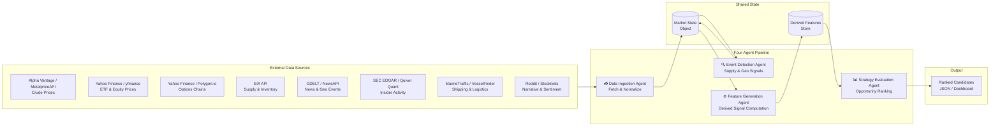

# Energy Options Opportunity Agent — User Guide

> **Version 1.0 · March 2026**
> This guide walks you through installing, configuring, and running the full four-agent pipeline that identifies options trading opportunities driven by oil market instability.

---

## Table of Contents

1. [Overview](#overview)
2. [Prerequisites](#prerequisites)
3. [Setup & Configuration](#setup--configuration)
4. [Running the Pipeline](#running-the-pipeline)
5. [Interpreting the Output](#interpreting-the-output)
6. [Troubleshooting](#troubleshooting)

---

## Overview

The **Energy Options Opportunity Agent** is a modular Python pipeline composed of four loosely coupled agents. It ingests market data, supply signals, news events, and alternative datasets, then produces structured, ranked options strategy candidates — each with a computed **edge score** and full signal attribution for explainability.

### Pipeline Architecture



Data flows **unidirectionally**: raw feeds are ingested and normalized → events are detected and scored → features are derived → strategies are evaluated and ranked.

### What Each Agent Does

| Agent | Role | Key Outputs |
|---|---|---|
| **Data Ingestion Agent** | Fetch & Normalize | Unified market state object; historical price/IV storage |
| **Event Detection Agent** | Supply & Geo Signals | Scored supply disruptions, refinery outages, chokepoint events |
| **Feature Generation Agent** | Derived Signal Computation | Volatility gaps, curve steepness, dispersion, narrative velocity, shock probability |
| **Strategy Evaluation Agent** | Opportunity Ranking | Ranked candidate list with edge scores and signal references |

### In-Scope Instruments (MVP)

| Category | Instruments |
|---|---|
| Crude Futures | Brent Crude, WTI (`CL=F`) |
| ETFs | USO, XLE |
| Energy Equities | Exxon Mobil (XOM), Chevron (CVX) |

### In-Scope Option Structures (MVP)

| Structure | Enum Value |
|---|---|
| Long Straddle | `long_straddle` |
| Call Spread | `call_spread` |
| Put Spread | `put_spread` |
| Calendar Spread | `calendar_spread` |

> **Advisory only.** The system does **not** execute trades automatically. All output is for informational and analytical purposes.

---

## Prerequisites

### System Requirements

| Requirement | Minimum |
|---|---|
| Operating System | Linux, macOS, or Windows (WSL2 recommended) |
| Python | 3.10 or later |
| RAM | 2 GB |
| Disk | 10 GB (for 6–12 months of historical data) |
| Network | Outbound HTTPS access to all data source APIs |

### Required Tools

```bash
# Verify Python version
python --version   # must be >= 3.10

# Verify pip
pip --version

# Optional but recommended: verify Docker if using container deployment
docker --version
```

### API Accounts

Register for the following free-tier accounts before proceeding. All sources are free or low-cost.

| Data Source | Service | Sign-up URL | Free Tier Notes |
|---|---|---|---|
| Crude Prices | Alpha Vantage | https://www.alphavantage.co | Free API key; rate-limited |
| Crude Prices (alt) | MetalpriceAPI | https://metalpriceapi.com | Free tier available |
| ETF/Equity/Options | Yahoo Finance (`yfinance`) | No key required | Public library |
| Options (extended) | Polygon.io | https://polygon.io | Free tier; limited history |
| Supply & Inventory | EIA API | https://www.eia.gov/opendata | Free; weekly updates |
| News & Geo Events | GDELT | https://www.gdeltproject.org | Free; no key needed |
| News & Geo Events (alt) | NewsAPI | https://newsapi.org | Free developer tier |
| Insider Activity | SEC EDGAR | https://efts.sec.gov/LATEST/search-index | Free; no key required |
| Insider Activity (alt) | Quiver Quant | https://www.quiverquant.com | Free/limited |
| Shipping | MarineTraffic | https://www.marinetraffic.com | Free tier |
| Shipping (alt) | VesselFinder | https://www.vesselfinder.com | Free tier |
| Sentiment | Reddit API | https://www.reddit.com/dev/api | Free |
| Sentiment | Stocktwits | https://api.stocktwits.com/developers | Free |

---

## Setup & Configuration

### 1. Clone the Repository

```bash
git clone https://github.com/your-org/energy-options-agent.git
cd energy-options-agent
```

### 2. Create and Activate a Virtual Environment

```bash
python -m venv .venv

# macOS / Linux
source .venv/bin/activate

# Windows (PowerShell)
.venv\Scripts\Activate.ps1
```

### 3. Install Dependencies

```bash
pip install --upgrade pip
pip install -r requirements.txt
```

### 4. Configure Environment Variables

Copy the provided template and populate it with your API credentials:

```bash
cp .env.example .env
```

Open `.env` in your editor and fill in each value. The full set of supported variables is listed below.

#### Environment Variable Reference

| Variable | Required | Default | Description |
|---|---|---|---|
| `ALPHA_VANTAGE_API_KEY` | ✅ Yes | — | API key for Alpha Vantage crude price feed |
| `METALPRICE_API_KEY` | ⬜ Optional | — | Fallback key for MetalpriceAPI crude feed |
| `POLYGON_API_KEY` | ⬜ Optional | — | Polygon.io key for extended options chain data |
| `EIA_API_KEY` | ✅ Yes | — | EIA Open Data API key for inventory/refinery data |
| `NEWSAPI_KEY` | ⬜ Optional | — | NewsAPI key for headline ingestion |
| `REDDIT_CLIENT_ID` | ⬜ Optional | — | Reddit OAuth client ID for sentiment feed |
| `REDDIT_CLIENT_SECRET` | ⬜ Optional | — | Reddit OAuth client secret |
| `REDDIT_USER_AGENT` | ⬜ Optional | `energy-agent/1.0` | Reddit API user-agent string |
| `QUIVER_QUANT_API_KEY` | ⬜ Optional | — | Quiver Quant key for insider activity data |
| `MARINETRAFFIC_API_KEY` | ⬜ Optional | — | MarineTraffic key for tanker flow data |
| `VESSELFINDER_API_KEY` | ⬜ Optional | — | VesselFinder alternative shipping feed key |
| `DATA_DIR` | ✅ Yes | `./data` | Local path for raw and derived data storage |
| `HISTORY_DAYS` | ⬜ Optional | `365` | Days of historical data to retain (180–365 recommended) |
| `MARKET_REFRESH_INTERVAL` | ⬜ Optional | `300` | Seconds between market data refresh cycles |
| `EIA_REFRESH_INTERVAL` | ⬜ Optional | `86400` | Seconds between EIA inventory data refresh (daily) |
| `LOG_LEVEL` | ⬜ Optional | `INFO` | Logging verbosity: `DEBUG`, `INFO`, `WARNING`, `ERROR` |
| `OUTPUT_DIR` | ✅ Yes | `./output` | Directory where ranked candidate JSON files are written |
| `EDGE_SCORE_THRESHOLD` | ⬜ Optional | `0.20` | Minimum edge score for a candidate to be included in output |
| `MAX_CANDIDATES` | ⬜ Optional | `20` | Maximum number of ranked candidates per pipeline run |
| `PIPELINE_MODE` | ⬜ Optional | `full` | Run mode: `full` \| `ingest_only` \| `features_only` \| `strategy_only` |

> **Tip:** Variables marked **Optional** fall back to free public endpoints (e.g., `yfinance`, GDELT, SEC EDGAR) when the corresponding key is absent. The pipeline will not fail if optional keys are missing; it will emit a warning and skip that data source.

#### Example `.env` File

```dotenv
# === Required ===
ALPHA_VANTAGE_API_KEY=your_alpha_vantage_key_here
EIA_API_KEY=your_eia_key_here
DATA_DIR=./data
OUTPUT_DIR=./output

# === Optional but recommended ===
POLYGON_API_KEY=your_polygon_key_here
NEWSAPI_KEY=your_newsapi_key_here
REDDIT_CLIENT_ID=your_reddit_client_id
REDDIT_CLIENT_SECRET=your_reddit_client_secret
REDDIT_USER_AGENT=energy-agent/1.0

# === Pipeline tuning ===
HISTORY_DAYS=365
MARKET_REFRESH_INTERVAL=300
EIA_REFRESH_INTERVAL=86400
LOG_LEVEL=INFO
EDGE_SCORE_THRESHOLD=0.20
MAX_CANDIDATES=20
PIPELINE_MODE=full
```

### 5. Initialise the Data Directory

Run the initialisation script to create the required directory structure and seed the historical data store:

```bash
python -m agent.init --days ${HISTORY_DAYS:-365}
```

Expected output:

```
[INFO] Creating data directory: ./data
[INFO] Creating output directory: ./output
[INFO] Seeding historical crude prices (365 days)...
[INFO] Seeding historical ETF/equity prices (365 days)...
[INFO] Seeding historical options chains (365 days)...
[INFO] Initialisation complete.
```

> **Note:** The initial seed may take several minutes depending on API rate limits. Alpha Vantage free-tier requests are throttled to 5 requests/minute.

---

## Running the Pipeline

### Pipeline Execution Flow

```mermaid
sequenceDiagram
    participant User
    participant CLI as pipeline CLI
    participant DIA as Data Ingestion Agent
    participant EDA as Event Detection Agent
    participant FGA as Feature Generation Agent
    participant SEA as Strategy Evaluation Agent
    participant Disk as Output / Data Store

    User->>CLI: python -m agent.pipeline run
    CLI->>DIA: Fetch & normalize market data
    DIA->>Disk: Write market state object
    DIA-->>CLI: ✅ Ingestion complete
    CLI->>EDA: Detect supply & geo events
    EDA->>Disk: Read market state; write scored events
    EDA-->>CLI: ✅ Event detection complete
    CLI->>FGA: Compute derived signals
    FGA->>Disk: Read market state + events; write features store
    FGA-->>CLI: ✅ Feature generation complete
    CLI->>SEA: Evaluate & rank strategies
    SEA->>Disk: Read features store; write ranked candidates JSON
    SEA-->>CLI: ✅ Strategy evaluation complete
    CLI-->>User: Output written to ./output/candidates_<timestamp>.json
```

### Running a Full Pipeline Cycle

```bash
# Single run — executes all four agents in sequence
python -m agent.pipeline run
```

### Running in Continuous Mode

```bash
# Repeat the full pipeline on the configured MARKET_REFRESH_INTERVAL
python -m agent.pipeline run --continuous
```

### Running Individual Agents

You can run any single agent in isolation for debugging or incremental development:

```bash
# Data Ingestion Agent only
python -m agent.pipeline run --mode ingest_only

# Event Detection Agent only (requires existing market state)
python -m agent.pipeline run --mode events_only

# Feature Generation Agent only (requires existing market state + events)
python -m agent.pipeline run --mode features_only

# Strategy Evaluation Agent only (requires existing features store)
python -m agent.pipeline run --mode strategy_only
```

### Common CLI Flags

| Flag | Description |
|---|---|
| `--continuous` | Run indefinitely, sleeping `MARKET_REFRESH_INTERVAL` seconds between cycles |
| `--mode <mode>` | Restrict execution to a single agent (see above) |
| `--output-dir <path>` | Override `OUTPUT_DIR` for this run |
| `--log-level <level>` | Override `LOG_LEVEL` for this run (`DEBUG`, `INFO`, `WARNING`, `ERROR`) |
| `--dry-run` | Execute all agents but suppress writing output files |
| `--no-cache` | Force re-fetch of all data sources, ignoring cached state |

### Example: Full Run with Debug Logging

```bash
python -m agent.pipeline run --log-level DEBUG
```

### Docker Deployment (Optional)

For lightweight cloud or containerised deployment:

```bash
# Build the image
docker build -t energy-options-agent:1.0 .

# Run a single pipeline cycle
docker run --rm \
  --env-file .env \
  -v $(pwd)/data:/app/data \
  -v $(pwd)/output:/app/output \
  energy-options-agent:1.0

# Run continuously
docker run -d \
  --name energy-agent \
  --env-file .env \
  -v $(pwd)/data:/app/data \
  -v $(pwd)/output:/app/output \
  energy-options-agent:1.0 \
  python -m agent.pipeline run --continuous
```

---

## Interpreting the Output

### Output File Location

Each pipeline run writes a timestamped JSON file to `OUTPUT_DIR`:

```
./output/candidates_2026-03-15T14:32:00Z.json
```

A symlink `./output/candidates_latest.json` always points to the most recent file.

### Output Schema

Each file contains a JSON array of strategy candidate objects, ordered by `edge_score` descending (highest confidence first).

| Field | Type | Description |
|---|---|---|
| `instrument` | `string` | Target instrument, e.g. `USO`, `XLE`, `CL=F` |
| `structure` | `enum` | Options structure: `long_straddle` \| `call_spread` \| `put_spread` \| `calendar_spread` |
| `expiration` | `integer` (days) | Target expiration in calendar days from the evaluation date |
| `edge_score` | `float` [0.0–1.0] | Composite opportunity score; higher = stronger signal confluence |
| `signals` | `object` | Map of contributing signals and their assessed values |
| `generated_at` | ISO 8601 datetime | UTC timestamp of candidate generation |

### Example Output

```json
[
  {
    "instrument": "USO",
    "structure": "long_straddle",
    "expiration": 30,
    "edge_score": 0.