# Energy Options Opportunity Agent — User Guide

> **Version 1.0 · March 2026**
> This guide walks a developer through setting up, configuring, and running the full four-agent pipeline end-to-end.

---

## Table of Contents

1. [Overview](#overview)
2. [Prerequisites](#prerequisites)
3. [Setup & Configuration](#setup--configuration)
4. [Running the Pipeline](#running-the-pipeline)
5. [Interpreting the Output](#interpreting-the-output)
6. [Troubleshooting](#troubleshooting)

---

## Overview

The **Energy Options Opportunity Agent** is an autonomous, modular Python pipeline that detects volatility mispricing in oil-related instruments and surfaces ranked options trading candidates with full signal explainability.

The pipeline is composed of four loosely coupled agents that pass data through a shared **market state object** and a **derived features store**:

```mermaid
flowchart LR
    subgraph Ingestion ["① Data Ingestion Agent"]
        direction TB
        A1[Crude Prices\nAlpha Vantage / MetalpriceAPI]
        A2[ETF & Equity Prices\nyfinance / Yahoo Finance]
        A3[Options Chains\nYahoo Finance / Polygon.io]
    end

    subgraph Detection ["② Event Detection Agent"]
        direction TB
        B1[News & Geo Events\nGDELT / NewsAPI]
        B2[Supply & Inventory\nEIA API]
        B3[Shipping & Logistics\nMarineTraffic / VesselFinder]
    end

    subgraph Features ["③ Feature Generation Agent"]
        direction TB
        C1[Volatility Gap\nRealized vs Implied]
        C2[Futures Curve Steepness]
        C3[Sector Dispersion]
        C4[Insider Conviction Score\nEDGAR / Quiver Quant]
        C5[Narrative Velocity\nReddit / Stocktwits]
        C6[Supply Shock Probability]
    end

    subgraph Strategy ["④ Strategy Evaluation Agent"]
        direction TB
        D1[Long Straddles]
        D2[Call / Put Spreads]
        D3[Calendar Spreads]
    end

    RAW[(Market State\nObject)] --> Detection
    Ingestion --> RAW
    Detection --> FEAT[(Derived\nFeatures Store)]
    Features --> FEAT
    FEAT --> Strategy
    Strategy --> OUT[[Ranked JSON\nCandidates]]
```



**Data flows strictly left-to-right.** No agent writes back to an upstream stage, so each agent can be deployed and updated independently.

### In-scope instruments (MVP)

| Category | Instruments |
|---|---|
| Crude futures | Brent Crude, WTI (`CL=F`) |
| ETFs | USO, XLE |
| Energy equities | Exxon Mobil (XOM), Chevron (CVX) |

### In-scope option structures (MVP)

`long_straddle` · `call_spread` · `put_spread` · `calendar_spread`

> **Advisory only.** The system produces recommendations; it does **not** execute trades automatically.

---

## Prerequisites

| Requirement | Minimum version / notes |
|---|---|
| Python | 3.10 or later |
| pip | 22.0 or later |
| Git | Any recent version |
| Docker *(optional)* | 24.x — for containerised deployment |
| Disk space | 5 GB recommended for 6–12 months of historical data |
| Internet access | Required for all external data feeds |

### API accounts you need to create

All feeds used in MVP phases 1–3 are free or free-tier. Register for the following before running the pipeline:

| Service | Sign-up URL | Provides |
|---|---|---|
| Alpha Vantage | <https://www.alphavantage.co/support/#api-key> | WTI / Brent spot prices |
| MetalpriceAPI *(optional fallback)* | <https://metalpriceapi.com> | Crude price fallback |
| Polygon.io | <https://polygon.io> | Options chains (free tier) |
| EIA Open Data | <https://www.eia.gov/opendata/register.php> | Inventory & refinery data |
| NewsAPI | <https://newsapi.org/register> | Energy news headlines |
| SEC EDGAR | No key required | Insider filings (public) |
| Quiver Quant *(optional)* | <https://www.quiverquant.com> | Parsed insider trades |
| MarineTraffic | <https://www.marinetraffic.com/en/register> | Tanker flow data (free tier) |

> **Note:** GDELT, yfinance, Reddit (`praw`), and Stocktwits do not require API keys for free-tier access used in the MVP.

---

## Setup & Configuration

### 1 · Clone the repository

```bash
git clone https://github.com/your-org/energy-options-agent.git
cd energy-options-agent
```

### 2 · Create and activate a virtual environment

```bash
python -m venv .venv
source .venv/bin/activate      # macOS / Linux
# .venv\Scripts\activate       # Windows PowerShell
```

### 3 · Install dependencies

```bash
pip install --upgrade pip
pip install -r requirements.txt
```

### 4 · Configure environment variables

Copy the provided template and fill in your credentials:

```bash
cp .env.example .env
```

Open `.env` in your editor and populate every variable below.

#### Environment variable reference

| Variable | Required | Default | Description |
|---|---|---|---|
| `ALPHA_VANTAGE_API_KEY` | ✅ | — | API key for WTI / Brent crude prices (Alpha Vantage) |
| `METALPRICE_API_KEY` | ⬜ | — | Fallback crude price feed (MetalpriceAPI) |
| `POLYGON_API_KEY` | ✅ | — | Options chain data (Polygon.io free tier) |
| `EIA_API_KEY` | ✅ | — | EIA inventory & refinery utilization |
| `NEWS_API_KEY` | ✅ | — | Energy news headlines (NewsAPI) |
| `QUIVER_API_KEY` | ⬜ | — | Parsed insider trades (Quiver Quant); falls back to raw EDGAR if unset |
| `MARINE_TRAFFIC_API_KEY` | ⬜ | — | Tanker flow data (MarineTraffic free tier) |
| `DATA_DIR` | ⬜ | `./data` | Local directory for raw and derived historical data |
| `OUTPUT_DIR` | ⬜ | `./output` | Directory where ranked JSON candidates are written |
| `LOG_LEVEL` | ⬜ | `INFO` | Python logging level (`DEBUG`, `INFO`, `WARNING`, `ERROR`) |
| `MARKET_DATA_INTERVAL_SECONDS` | ⬜ | `60` | Polling cadence for minute-level market feeds |
| `SLOW_FEED_INTERVAL_SECONDS` | ⬜ | `86400` | Polling cadence for daily/weekly feeds (EIA, EDGAR) |
| `HISTORY_RETENTION_DAYS` | ⬜ | `365` | Days of raw and derived data to retain on disk |
| `MIN_EDGE_SCORE` | ⬜ | `0.30` | Candidates below this edge score are suppressed from output |
| `INSTRUMENTS` | ⬜ | `USO,XLE,XOM,CVX,CL=F,BZ=F` | Comma-separated list of instruments to monitor |

Example `.env` snippet:

```dotenv
ALPHA_VANTAGE_API_KEY=YOUR_AV_KEY_HERE
POLYGON_API_KEY=YOUR_POLYGON_KEY_HERE
EIA_API_KEY=YOUR_EIA_KEY_HERE
NEWS_API_KEY=YOUR_NEWSAPI_KEY_HERE

DATA_DIR=./data
OUTPUT_DIR=./output
LOG_LEVEL=INFO
MIN_EDGE_SCORE=0.30
```

### 5 · Initialise the data store

This creates the directory structure and runs the first historical backfill:

```bash
python -m agent.cli init
```

Expected output:

```
[INFO] Data directory created at ./data
[INFO] Output directory created at ./output
[INFO] Running historical backfill for 365 days...
[INFO] Backfill complete. 4 agents initialised.
```

---

## Running the Pipeline

### Full pipeline — single run

Executes all four agents once in sequence and writes output to `OUTPUT_DIR`:

```bash
python -m agent.cli run
```

### Full pipeline — continuous mode

Runs the pipeline on a repeating cadence driven by `MARKET_DATA_INTERVAL_SECONDS`:

```bash
python -m agent.cli run --loop
```

Press **Ctrl-C** to stop gracefully.

### Running individual agents

You can run any agent independently without disrupting the rest of the pipeline:

```bash
# Data Ingestion Agent only
python -m agent.cli run --agent ingestion

# Event Detection Agent only
python -m agent.cli run --agent detection

# Feature Generation Agent only
python -m agent.cli run --agent features

# Strategy Evaluation Agent only
python -m agent.cli run --agent strategy
```

### Phase-gated execution

To limit the pipeline to a specific MVP phase (useful when a data source is not yet available):

```bash
python -m agent.cli run --phase 1   # Core market signals & options only
python -m agent.cli run --phase 2   # + Supply & event augmentation
python -m agent.cli run --phase 3   # + Alternative / contextual signals (full MVP)
```

| Phase flag | Agents active | Additional data sources unlocked |
|---|---|---|
| `--phase 1` | Ingestion, Features (partial), Strategy | Alpha Vantage, yfinance, Polygon.io |
| `--phase 2` | + Event Detection | EIA, GDELT, NewsAPI |
| `--phase 3` | All four agents | EDGAR / Quiver Quant, MarineTraffic, Reddit, Stocktwits |

### Docker (optional)

Build and run the full pipeline inside a container:

```bash
docker build -t energy-options-agent:latest .

docker run --rm \
  --env-file .env \
  -v "$(pwd)/data:/app/data" \
  -v "$(pwd)/output:/app/output" \
  energy-options-agent:latest run --loop
```

---

## Interpreting the Output

### Output location

Each pipeline run appends a timestamped JSON file to `OUTPUT_DIR`:

```
output/
└── candidates_2026-03-15T14:32:00Z.json
```

A convenience symlink `output/latest.json` always points to the most recent file.

### Output schema

Each file contains a JSON array of strategy candidate objects:

| Field | Type | Description |
|---|---|---|
| `instrument` | `string` | Target instrument, e.g. `USO`, `XLE`, `CL=F` |
| `structure` | `enum` | `long_straddle` · `call_spread` · `put_spread` · `calendar_spread` |
| `expiration` | `integer` | Target expiration in calendar days from evaluation date |
| `edge_score` | `float [0.0–1.0]` | Composite opportunity score — **higher = stronger signal confluence** |
| `signals` | `object` | Map of contributing signals and their qualitative values |
| `generated_at` | `ISO 8601 datetime` | UTC timestamp of candidate generation |

### Example candidate

```json
{
  "instrument": "USO",
  "structure": "long_straddle",
  "expiration": 30,
  "edge_score": 0.47,
  "signals": {
    "tanker_disruption_index": "high",
    "volatility_gap": "positive",
    "narrative_velocity": "rising"
  },
  "generated_at": "2026-03-15T14:32:00Z"
}
```

### Reading the edge score

| Edge score range | Interpretation | Suggested action |
|---|---|---|
| `0.70 – 1.00` | Strong signal confluence | Review carefully; high-conviction candidate |
| `0.50 – 0.69` | Moderate confluence | Consider in context of broader market view |
| `0.30 – 0.49` | Weak / emerging signal | Monitor; not yet actionable for most setups |
| `< 0.30` | Below threshold | Suppressed from output by default (`MIN_EDGE_SCORE`) |

### Reading the signals map

The `signals` object explains **why** a candidate was surfaced. Each key maps to a qualitative value:

| Signal key | What it measures | Qualitative values |
|---|---|---|
| `volatility_gap` | Realized IV vs. implied IV spread | `positive` · `negative` · `neutral` |
| `futures_curve_steepness` | Contango / backwardation degree | `steep` · `flat` · `inverted` |
| `sector_dispersion` | Cross-sector correlation divergence | `high` · `normal` · `low` |
| `insider_conviction_score` | Executive trade signal strength | `high` · `moderate` · `low` |
| `narrative_velocity` | Headline / social acceleration | `rising` · `stable` · `falling` |
| `tanker_disruption_index` | Tanker flow anomaly magnitude | `high` · `moderate` · `low` |
| `supply_shock_probability` | Model probability of supply event | `high` · `moderate` · `low` |

### Viewing output in thinkorswim or another dashboard

The JSON output is compatible with any JSON-capable dashboard. For thinkorswim, import `output/latest.json` using the platform's **custom data** or scripting interface to visualise ranked candidates alongside your options chain.

---

## Troubleshooting

### Pipeline fails to start

| Symptom | Likely cause | Fix |
|---|---|---|
| `KeyError: 'ALPHA_VANTAGE_API_KEY'` | Missing environment variable | Verify `.env` is present and `cp .env.example .env` was run |
| `ModuleNotFoundError` | Dependencies not installed | Run `pip install -r requirements.txt` inside the activated venv |
| `PermissionError` on `./data` or `./output` | Directory permissions | Run `mkdir -p data output && chmod 755 data output` |

### A specific agent fails mid-run

The pipeline is designed to **tolerate delayed or missing data without total failure**. If a single agent errors:

- The run continues with the data available from other agents.
- The failed agent logs a `WARNING` with the source and error message.
- Downstream agents use the last successfully stored state for that data layer.

Check the log output for lines like:

```
[WARNING] Event Detection Agent: EIA feed unavailable (HTTP 503). Using cached state from 2026-03-14T08:00:00Z.
```

### No candidates appear in output

1. **Check `MIN_EDGE_SCORE`** — lower it temporarily to `0.10` to confirm the pipeline is producing candidates at all:
   ```bash
   MIN_EDGE_SCORE=0.10 python -m agent.cli run
   ```
2. **Check the data backfill** — ensure historical data was initialised:
   ```bash
   python -m agent.cli init --force
   ```
3. **Verify options chain data** — Polygon.io free-tier data is delayed. Confirm your account tier supports the instruments configured in `INSTRUMENTS`.

### Rate limit errors from data sources

| Source | Typical free-tier limit | Mitigation |
|---|---|---|
| Alpha Vantage | 25 requests / day (free) | Increase `MARKET_DATA_INTERVAL_SECONDS`; or upgrade plan |
| Polygon.io | 5 API calls / minute (free) | Reduce instrument count in `INSTRUMENTS` |
| NewsAPI | 100 requests / day (free) | Increase `SLOW_FEED_INTERVAL_SECONDS` for news polling |
| MarineTraffic | Limited on free tier | Use `--phase 2` to defer shipping data until a paid tier is available |

### Stale or