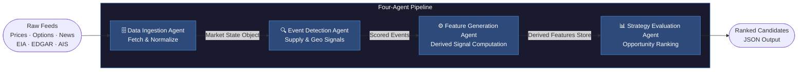
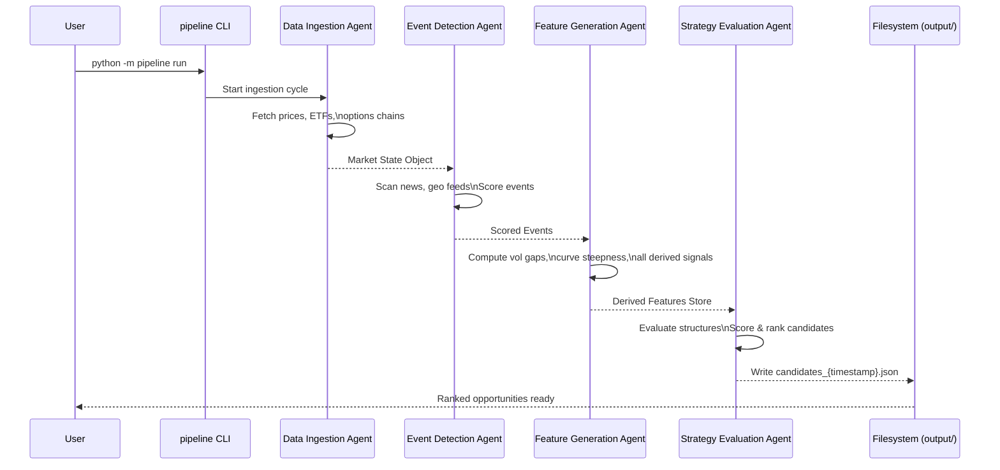

# Energy Options Opportunity Agent — User Guide

> **Version 1.0 · March 2026**
> This guide walks you through installing, configuring, and running the full four-agent pipeline end-to-end.

---

## Table of Contents

1. [Overview](#overview)
2. [Prerequisites](#prerequisites)
3. [Setup & Configuration](#setup--configuration)
4. [Running the Pipeline](#running-the-pipeline)
5. [Interpreting the Output](#interpreting-the-output)
6. [Troubleshooting](#troubleshooting)

---

## Overview

The **Energy Options Opportunity Agent** is an autonomous, modular Python pipeline that identifies options trading opportunities driven by oil market instability. It ingests market data, supply signals, news events, and alternative datasets, then produces a ranked list of candidate options strategies with full signal explainability.

### Pipeline Architecture

The system is composed of four loosely coupled agents. Data flows **unidirectionally** through the pipeline:



### What Each Agent Does

| Agent | Role | Key Responsibilities |
|---|---|---|
| **Data Ingestion** | Fetch & Normalize | Pulls crude prices, ETF/equity data, and options chains; converts feeds into a unified market state object; stores historical data |
| **Event Detection** | Supply & Geo Signals | Monitors news and geopolitical feeds; identifies supply disruptions, refinery outages, and tanker chokepoints; assigns confidence/intensity scores |
| **Feature Generation** | Derived Signal Computation | Computes volatility gaps, futures curve steepness, sector dispersion, insider conviction scores, narrative velocity, and supply shock probability |
| **Strategy Evaluation** | Opportunity Ranking | Evaluates eligible option structures; generates ranked candidates with edge scores and contributing signal references |

### In-Scope Instruments & Structures

**Instruments**

| Type | Instruments |
|---|---|
| Crude Futures | Brent Crude, WTI (`CL=F`) |
| ETFs | USO, XLE |
| Energy Equities | Exxon Mobil (XOM), Chevron (CVX) |

**Option Structures (MVP)**

- Long straddles
- Call / put spreads
- Calendar spreads

> **Note:** Automated trade execution is explicitly out of scope. The system is **advisory only**.

---

## Prerequisites

Before setting up the pipeline, ensure the following are in place.

### Software Requirements

| Requirement | Minimum Version | Notes |
|---|---|---|
| Python | 3.10+ | `python3 --version` to confirm |
| pip | 23+ | Bundled with Python 3.10+ |
| Git | Any recent | For cloning the repository |
| Docker *(optional)* | 24+ | For containerized deployment |

### API Keys & Data Source Access

All primary data sources are free or low-cost. Obtain credentials before proceeding.

| Data Source | What You Need | Where to Register |
|---|---|---|
| Alpha Vantage | Free API key | [alphavantage.co](https://www.alphavantage.co/support/#api-key) |
| Polygon.io | Free tier API key | [polygon.io](https://polygon.io/) |
| EIA API | Free API key | [eia.gov/opendata](https://www.eia.gov/opendata/) |
| NewsAPI | Free tier API key | [newsapi.org](https://newsapi.org/) |
| SEC EDGAR | No key required | Public API |
| MarineTraffic / VesselFinder | Free tier account | [marinetraffic.com](https://www.marinetraffic.com/) |
| GDELT | No key required | Public dataset |
| Reddit / Stocktwits | No key required (public endpoints) | — |

> `yfinance` (Yahoo Finance) requires no API key and is used for ETF/equity prices and options chain data.

### System Resources

The pipeline is designed to run on a **single VM or local machine**. Recommended minimums:

| Resource | Minimum | Recommended |
|---|---|---|
| CPU | 2 cores | 4 cores |
| RAM | 4 GB | 8 GB |
| Disk | 10 GB | 50 GB (6–12 months of historical data) |

---

## Setup & Configuration

### 1. Clone the Repository

```bash
git clone https://github.com/your-org/energy-options-agent.git
cd energy-options-agent
```

### 2. Create a Virtual Environment

```bash
python3 -m venv .venv
source .venv/bin/activate        # macOS / Linux
# .venv\Scripts\activate         # Windows PowerShell
```

### 3. Install Dependencies

```bash
pip install --upgrade pip
pip install -r requirements.txt
```

### 4. Configure Environment Variables

The pipeline reads all secrets and tunable parameters from environment variables. Copy the provided template and fill in your values:

```bash
cp .env.example .env
```

Then open `.env` in your editor and populate each variable. The full reference table is below.

#### Environment Variable Reference

| Variable | Required | Default | Description |
|---|---|---|---|
| `ALPHA_VANTAGE_API_KEY` | ✅ | — | API key for crude price feeds (WTI, Brent) |
| `POLYGON_API_KEY` | ✅ | — | API key for options chain data (strike, expiry, IV, volume) |
| `EIA_API_KEY` | ✅ | — | API key for weekly inventory and refinery utilization data |
| `NEWSAPI_KEY` | ✅ | — | API key for energy news and geopolitical event feeds |
| `MARINETRAFFIC_API_KEY` | ⬜ | — | Free-tier key for tanker flow data (Phase 3+) |
| `QUIVER_QUANT_API_KEY` | ⬜ | — | API key for insider activity data via Quiver Quant |
| `DATA_DIR` | ⬜ | `./data` | Local directory for persisted raw and derived data |
| `OUTPUT_DIR` | ⬜ | `./output` | Directory where ranked candidate JSON files are written |
| `LOG_LEVEL` | ⬜ | `INFO` | Logging verbosity: `DEBUG`, `INFO`, `WARNING`, `ERROR` |
| `INGESTION_INTERVAL_SECONDS` | ⬜ | `300` | How often the ingestion agent polls minute-cadence feeds |
| `HISTORY_RETENTION_DAYS` | ⬜ | `180` | Days of historical data to retain (minimum 180, up to 365) |
| `EDGE_SCORE_THRESHOLD` | ⬜ | `0.30` | Minimum edge score `[0.0–1.0]` for a candidate to appear in output |
| `TARGET_INSTRUMENTS` | ⬜ | `USO,XLE,XOM,CVX,CL=F` | Comma-separated list of instruments to evaluate |
| `TARGET_STRUCTURES` | ⬜ | `long_straddle,call_spread,put_spread,calendar_spread` | Eligible option structures |

> **Tip:** Variables marked ⬜ are optional for the MVP (Phase 1 & 2). They are required for Phase 3 alternative signal layers. The pipeline will log a warning and skip that data layer if an optional key is absent — it will **not** crash.

#### Example `.env` file

```dotenv
# --- Required ---
ALPHA_VANTAGE_API_KEY=YOUR_ALPHA_VANTAGE_KEY
POLYGON_API_KEY=YOUR_POLYGON_KEY
EIA_API_KEY=YOUR_EIA_KEY
NEWSAPI_KEY=YOUR_NEWSAPI_KEY

# --- Optional: Alternative Signals (Phase 3) ---
MARINETRAFFIC_API_KEY=YOUR_MARINETRAFFIC_KEY
QUIVER_QUANT_API_KEY=YOUR_QUIVER_KEY

# --- Pipeline Behaviour ---
DATA_DIR=./data
OUTPUT_DIR=./output
LOG_LEVEL=INFO
INGESTION_INTERVAL_SECONDS=300
HISTORY_RETENTION_DAYS=180
EDGE_SCORE_THRESHOLD=0.30
TARGET_INSTRUMENTS=USO,XLE,XOM,CVX,CL=F
TARGET_STRUCTURES=long_straddle,call_spread,put_spread,calendar_spread
```

### 5. Initialize the Data Directory

Run the initialization script once to create the required directory structure and verify connectivity to all configured data sources:

```bash
python -m pipeline init
```

Expected output:

```
[INFO] Creating data directory at ./data ...  OK
[INFO] Creating output directory at ./output ... OK
[INFO] Checking Alpha Vantage connectivity ...  OK
[INFO] Checking Polygon.io connectivity ...     OK
[INFO] Checking EIA API connectivity ...        OK
[INFO] Checking NewsAPI connectivity ...        OK
[INFO] Checking yfinance (Yahoo Finance) ...    OK
[WARN] MARINETRAFFIC_API_KEY not set — tanker signal layer will be skipped.
[WARN] QUIVER_QUANT_API_KEY not set — insider conviction layer will be skipped.
[INFO] Initialization complete. Ready to run pipeline.
```

Warnings for optional keys are expected and safe to ignore during MVP phases.

---

## Running the Pipeline

### Pipeline Execution Flow



### Single Run (One-Shot)

Execute the full pipeline once and exit. Useful for on-demand evaluation or scheduled invocation via cron.

```bash
python -m pipeline run
```

To override the edge score threshold for this run only:

```bash
python -m pipeline run --edge-score-threshold 0.25
```

To restrict to specific instruments:

```bash
python -m pipeline run --instruments USO,XLE
```

### Continuous Mode (Polling)

Run the pipeline in a loop, repeating the ingestion cycle at the interval defined by `INGESTION_INTERVAL_SECONDS`:

```bash
python -m pipeline run --continuous
```

Stop with `Ctrl+C`. The pipeline completes the current cycle before exiting cleanly.

### Running Individual Agents

Each agent can be executed independently. This is useful for debugging a specific layer without re-running the full pipeline.

```bash
# Run only the Data Ingestion Agent
python -m pipeline run --agent ingestion

# Run only the Event Detection Agent (requires a prior market state snapshot)
python -m pipeline run --agent events

# Run only the Feature Generation Agent
python -m pipeline run --agent features

# Run only the Strategy Evaluation Agent
python -m pipeline run --agent strategy
```

### Running in Docker

Build and run the containerized pipeline:

```bash
# Build the image
docker build -t energy-options-agent:latest .

# Run a single cycle, mounting local data and output directories
docker run --rm \
  --env-file .env \
  -v "$(pwd)/data:/app/data" \
  -v "$(pwd)/output:/app/output" \
  energy-options-agent:latest \
  python -m pipeline run
```

For continuous mode in the background:

```bash
docker run -d \
  --name energy-agent \
  --env-file .env \
  -v "$(pwd)/data:/app/data" \
  -v "$(pwd)/output:/app/output" \
  energy-options-agent:latest \
  python -m pipeline run --continuous
```

### Scheduling via Cron (Linux / macOS)

To run a single cycle every 5 minutes using cron:

```bash
crontab -e
```

Add the following line (adjust paths to your installation):

```cron
*/5 * * * * /path/to/.venv/bin/python -m pipeline run >> /path/to/logs/pipeline.log 2>&1
```

---

## Interpreting the Output

### Output File Location

After each successful pipeline run, a JSON file is written to `OUTPUT_DIR`:

```
output/
└── candidates_2026-03-15T14:32:00Z.json
```

The filename encodes the UTC timestamp of candidate generation.

### Output Schema

Each file contains an array of candidate objects. Every candidate has the following fields:

| Field | Type | Description |
|---|---|---|
| `instrument` | `string` | Target instrument, e.g. `"USO"`, `"XLE"`, `"CL=F"` |
| `structure` | `enum` | Option structure: `long_straddle` · `call_spread` · `put_spread` · `calendar_spread` |
| `expiration` | `integer` | Target expiration in **calendar days** from the evaluation date |
| `edge_score` | `float [0.0–1.0]` | Composite opportunity score — higher values indicate stronger signal confluence |
| `signals` | `object` | Map of contributing signals and their qualitative state (see below) |
| `generated_at` | `ISO 8601 datetime` | UTC timestamp of when this candidate was generated |

### Example Output

```json
[
  {
    "instrument": "USO",
    "structure": "long_straddle",
    "expiration": 30,
    "edge_score": 0.47,
    "signals": {
      "tanker_disruption_index": "high",
      "volatility_gap": "positive",
      "narrative_velocity": "rising"
    },
    "generated_at": "2026-03-15T14:32:00Z"
  },
  {
    "instrument": "XLE",
    "structure": "call_spread",
    "expiration": 21,
    "edge_score": 0.38,
    "signals": {
      "volatility_gap": "positive",
      "supply_shock_probability": "elevated",
      "eia_inventory_draw": "large"
    },
    "generated_at": "2026-03-15T14:32:00Z"
  }
]
```

### Understanding the Edge Score

The `edge_score` is a composite `[0.0–1.0]` value reflecting signal confluence across all active pipeline layers. Use this as a **priority ranking**, not as a standalone trade signal.

| Edge Score Range | Interpretation | Suggested Action |
|---|---|---|
| `0.70 – 1.00` | Strong multi-signal confluence | High priority — review all contributing signals |
| `0.50 – 0.69` | Moderate confluence | Worth monitoring; validate signals manually