# Energy Options Opportunity Agent — User Guide

> **Version 1.0 • March 2026**
> This guide covers the full pipeline: setup, configuration, execution, output interpretation, and troubleshooting.

---

## Table of Contents

1. [Overview](#overview)
2. [Prerequisites](#prerequisites)
3. [Setup & Configuration](#setup--configuration)
4. [Running the Pipeline](#running-the-pipeline)
5. [Interpreting the Output](#interpreting-the-output)
6. [Troubleshooting](#troubleshooting)

---

## Overview

The **Energy Options Opportunity Agent** is an autonomous, modular Python pipeline that identifies options trading opportunities driven by oil market instability. It ingests market data, supply signals, news events, and alternative datasets to produce structured, ranked candidate options strategies.

The pipeline is composed of four loosely coupled agents that execute in sequence, communicating through a shared market state object and a derived features store:

```mermaid
flowchart LR
    subgraph Ingestion["① Data Ingestion Agent"]
        A1[Crude prices\nWTI · Brent]
        A2[ETF / Equity\nUSO · XLE · XOM · CVX]
        A3[Options chains\nIV · Strike · Volume]
    end

    subgraph Events["② Event Detection Agent"]
        B1[News & Geo feeds\nGDELT · NewsAPI]
        B2[Supply signals\nEIA · Shipping]
        B3[Confidence &\nIntensity scoring]
    end

    subgraph Features["③ Feature Generation Agent"]
        C1[Volatility gap\nRealised vs Implied]
        C2[Futures curve\nsteepness]
        C3[Sector dispersion\nInsider conviction\nNarrative velocity\nSupply shock prob.]
    end

    subgraph Strategy["④ Strategy Evaluation Agent"]
        D1[Evaluate eligible\nstructures]
        D2[Compute edge score]
        D3[Rank & emit\ncandidates]
    end

    RawFeeds[(External\nData Sources)] --> Ingestion
    Ingestion -->|Market State Object| Events
    Events -->|Scored Events| Features
    Features -->|Derived Signals| Strategy
    Strategy -->|JSON Output| Output[(Ranked\nCandidates)]
```



### What the pipeline produces

Each pipeline run emits a ranked list of candidate options strategies. Every candidate includes the target instrument, the recommended options structure, the target expiration, a composite edge score (0.0–1.0), and the contributing signals that explain the recommendation.

> **Advisory only.** The pipeline does not place trades. All output is informational and intended to support human decision-making.

### In-scope instruments and structures

| Category | Instruments |
|---|---|
| Crude futures | Brent Crude, WTI (`CL=F`) |
| ETFs | USO, XLE |
| Energy equities | Exxon Mobil (XOM), Chevron (CVX) |

| MVP Option Structures |
|---|
| Long straddles |
| Call spreads / Put spreads |
| Calendar spreads |

---

## Prerequisites

### System requirements

| Requirement | Minimum |
|---|---|
| Python | 3.10 or later |
| Operating system | Linux, macOS, or Windows (WSL2 recommended) |
| RAM | 2 GB |
| Disk | 5 GB free (for 6–12 months of historical data) |
| Network | Outbound HTTPS access to all data source APIs |

### Python dependencies

The pipeline uses standard open-source libraries. Install them from the project root:

```bash
pip install -r requirements.txt
```

Core dependencies include `yfinance`, `requests`, `pandas`, `numpy`, and `pydantic`. Refer to `requirements.txt` for pinned versions.

### External API accounts

All required data sources are free or free-tier. Register for credentials before running the pipeline:

| Source | Purpose | Registration URL |
|---|---|---|
| Alpha Vantage | WTI / Brent spot & futures prices | https://www.alphavantage.co/support/#api-key |
| Polygon.io | Options chains (free tier) | https://polygon.io |
| EIA API | Inventory & refinery utilization | https://www.eia.gov/opendata/ |
| NewsAPI | News & geopolitical event feeds | https://newsapi.org |
| SEC EDGAR | Insider activity | No key required (public) |
| GDELT | Geopolitical event stream | No key required (public) |
| MarineTraffic | Tanker shipping flows (free tier) | https://www.marinetraffic.com/en/p/api-services |
| Reddit API | Narrative / sentiment velocity | https://www.reddit.com/prefs/apps |

> **Tip:** GDELT and SEC EDGAR require no API key. You can run Phase 1 of the pipeline with only an Alpha Vantage key and a Polygon.io key.

---

## Setup & Configuration

### 1. Clone the repository

```bash
git clone https://github.com/your-org/energy-options-agent.git
cd energy-options-agent
```

### 2. Create and activate a virtual environment

```bash
python -m venv .venv
source .venv/bin/activate        # Linux / macOS
# .venv\Scripts\activate         # Windows
```

### 3. Install dependencies

```bash
pip install -r requirements.txt
```

### 4. Configure environment variables

The pipeline reads all secrets and tunable parameters from environment variables. Copy the provided template and fill in your values:

```bash
cp .env.example .env
```

Open `.env` in your editor and populate each variable. The full reference table is below.

#### Environment variable reference

| Variable | Required | Default | Description |
|---|---|---|---|
| `ALPHA_VANTAGE_API_KEY` | ✅ | — | API key for crude price feeds (WTI, Brent) |
| `POLYGON_API_KEY` | ✅ | — | API key for options chain data (strike, expiry, IV, volume) |
| `EIA_API_KEY` | ✅ | — | API key for EIA inventory and refinery utilization data |
| `NEWSAPI_KEY` | ✅ | — | API key for news and geopolitical event feeds |
| `MARINETRAFFIC_API_KEY` | ⬜ | — | API key for tanker shipping flow data (Phase 3) |
| `REDDIT_CLIENT_ID` | ⬜ | — | Reddit app client ID for narrative velocity signals (Phase 3) |
| `REDDIT_CLIENT_SECRET` | ⬜ | — | Reddit app client secret (Phase 3) |
| `REDDIT_USER_AGENT` | ⬜ | `energy-agent/1.0` | Reddit API user agent string (Phase 3) |
| `QUIVER_QUANT_API_KEY` | ⬜ | — | API key for insider conviction data from Quiver Quant (Phase 3) |
| `DATA_DIR` | ⬜ | `./data` | Local path for persisted raw and derived historical data |
| `OUTPUT_DIR` | ⬜ | `./output` | Directory where ranked candidate JSON files are written |
| `LOG_LEVEL` | ⬜ | `INFO` | Logging verbosity: `DEBUG`, `INFO`, `WARNING`, `ERROR` |
| `PIPELINE_PHASE` | ⬜ | `1` | Active MVP phase (`1`–`3`). Controls which agents and data sources are enabled |
| `MARKET_DATA_INTERVAL_MINUTES` | ⬜ | `5` | Polling cadence for minute-level market data feeds |
| `HISTORICAL_RETENTION_DAYS` | ⬜ | `365` | Number of days of raw and derived data to retain on disk |
| `EDGE_SCORE_THRESHOLD` | ⬜ | `0.30` | Minimum edge score for a candidate to appear in output |

> **Variables marked ⬜ are optional for Phase 1.** Set them before advancing to Phase 2 or Phase 3.

#### Example `.env` file

```dotenv
# --- Required ---
ALPHA_VANTAGE_API_KEY=your_alpha_vantage_key
POLYGON_API_KEY=your_polygon_key
EIA_API_KEY=your_eia_key
NEWSAPI_KEY=your_newsapi_key

# --- Optional (Phase 3) ---
MARINETRAFFIC_API_KEY=
REDDIT_CLIENT_ID=
REDDIT_CLIENT_SECRET=
REDDIT_USER_AGENT=energy-agent/1.0
QUIVER_QUANT_API_KEY=

# --- Pipeline behaviour ---
DATA_DIR=./data
OUTPUT_DIR=./output
LOG_LEVEL=INFO
PIPELINE_PHASE=1
MARKET_DATA_INTERVAL_MINUTES=5
HISTORICAL_RETENTION_DAYS=365
EDGE_SCORE_THRESHOLD=0.30
```

### 5. Initialise the data directory

Run the initialisation script to create the expected directory structure and validate your API keys:

```bash
python scripts/init_pipeline.py
```

Expected output:

```
[INFO] Data directory created at ./data
[INFO] Output directory created at ./output
[INFO] Alpha Vantage: OK
[INFO] Polygon.io:    OK
[INFO] EIA API:       OK
[INFO] NewsAPI:       OK
[INFO] Initialisation complete. Ready to run pipeline.
```

If any key check fails, the script reports the affected source and exits with a non-zero code.

---

## Running the Pipeline

### Pipeline phase overview

The pipeline supports incremental activation of agents and data sources through four defined phases. Set `PIPELINE_PHASE` in your `.env` to control which capabilities are active.

| Phase | Name | Agents active | Key additions |
|---|---|---|---|
| 1 | Core Market Signals & Options | Ingestion, Strategy Evaluation | WTI/Brent prices; USO/XLE options surface; long straddles, call/put spreads |
| 2 | Supply & Event Augmentation | + Event Detection | EIA inventory; GDELT/NewsAPI event detection; supply disruption scoring |
| 3 | Alternative / Contextual Signals | + Feature Generation (full) | Insider trades; narrative velocity; shipping data; full edge scoring |
| 4 | High-Fidelity Enhancements | All agents | OPIS pricing; exotic structures; execution integration (deferred) |

### Single run

Execute one full pipeline cycle and write candidates to the output directory:

```bash
python -m agent.pipeline run
```

The pipeline runs all agents enabled for the configured phase in sequence, then exits.

### Continuous polling mode

Run the pipeline on a recurring schedule. Market data is refreshed at the cadence defined by `MARKET_DATA_INTERVAL_MINUTES`; slower feeds (EIA, EDGAR) are fetched on their own daily or weekly schedule automatically:

```bash
python -m agent.pipeline run --watch
```

Stop the process with `Ctrl+C`. The pipeline completes the current cycle before exiting cleanly.

### Run a specific agent only

You can invoke individual agents for debugging or incremental development:

```bash
# Data Ingestion Agent only
python -m agent.pipeline run --agent ingestion

# Event Detection Agent only
python -m agent.pipeline run --agent events

# Feature Generation Agent only
python -m agent.pipeline run --agent features

# Strategy Evaluation Agent only
python -m agent.pipeline run --agent strategy
```

> **Note:** Running `strategy` in isolation requires a pre-existing market state and features store on disk from a prior ingestion run.

### Running in a container

A `Dockerfile` is provided for deployment on a single VM or container host:

```bash
docker build -t energy-options-agent .

docker run --env-file .env \
  -v $(pwd)/data:/app/data \
  -v $(pwd)/output:/app/output \
  energy-options-agent
```

Add `--watch` to the `CMD` override for continuous polling mode:

```bash
docker run --env-file .env \
  -v $(pwd)/data:/app/data \
  -v $(pwd)/output:/app/output \
  energy-options-agent python -m agent.pipeline run --watch
```

### Verifying a run

After a successful single run, the output directory contains a timestamped JSON file:

```bash
ls output/
# candidates_2026-03-15T14:32:00Z.json
```

Check the pipeline log for a summary line:

```
[INFO] Pipeline complete. 7 candidates generated. Top edge score: 0.74 (USO long_straddle).
```

---

## Interpreting the Output

### Output file format

Each pipeline run writes one JSON file to `OUTPUT_DIR`. The file contains an array of candidate objects, sorted by `edge_score` descending.

```json
[
  {
    "instrument": "USO",
    "structure": "long_straddle",
    "expiration": 30,
    "edge_score": 0.74,
    "signals": {
      "tanker_disruption_index": "high",
      "volatility_gap": "positive",
      "narrative_velocity": "rising"
    },
    "generated_at": "2026-03-15T14:32:00Z"
  },
  {
    "instrument": "XLE",
    "structure": "call_spread",
    "expiration": 45,
    "edge_score": 0.47,
    "signals": {
      "supply_shock_probability": "elevated",
      "futures_curve_steepness": "steep",
      "sector_dispersion": "high"
    },
    "generated_at": "2026-03-15T14:32:00Z"
  }
]
```

### Field reference

| Field | Type | Description |
|---|---|---|
| `instrument` | string | Target instrument, e.g. `USO`, `XLE`, `CL=F` |
| `structure` | enum | Options structure: `long_straddle`, `call_spread`, `put_spread`, `calendar_spread` |
| `expiration` | integer (days) | Target expiration in calendar days from the evaluation date |
| `edge_score` | float [0.0–1.0] | Composite opportunity score. Higher values indicate stronger signal confluence |
| `signals` | object | Map of contributing signals and their qualitative values |
| `generated_at` | ISO 8601 datetime | UTC timestamp of candidate generation |

### Reading the edge score

| Edge score range | Interpretation |
|---|---|
| 0.70–1.00 | Strong signal confluence — multiple independent signals align |
| 0.50–0.69 | Moderate confluence — worth monitoring; validate with your own research |
| 0.30–0.49 | Weak confluence — marginal signal; treat with caution |
| Below `EDGE_SCORE_THRESHOLD` | Filtered out — does not appear in output |

### Reading the signals map

Each key in the `signals` object corresponds to a derived feature computed by the Feature Generation Agent. Use this map to understand **why** a candidate was ranked where it was.

| Signal key | What it measures |
|---|---|
| `volatility_gap` | Direction of spread between realised and implied volatility |
| `futures_curve_steepness` | Degree of contango or backwardation in crude futures |
| `sector_dispersion` | Cross-instrument correlation breakdown within energy equities/ETFs |
| `insider_conviction_score` | Aggregated directional conviction from EDGAR insider filings |
| `narrative_velocity` | Rate of acceleration in energy-related headlines and social sentiment |
| `supply_shock_probability` | Model-estimated probability of a near-term supply disruption |
| `tanker_disruption_index` | Anomaly score derived from tanker routing and chokepoint data |

Signal values are qualitative strings (`low`, `moderate`, `high`, `positive`, `negative`, `rising`, `falling`, `elevated`). They indicate the direction or intensity of each signal at the time of evaluation.

### Consuming output in thinkorswim or other tools

The JSON output is compatible with any JSON-capable dashboard or scripting environment. To load it in Python for further analysis:

```python
import json
from pathlib import Path

candidates = json.loads(Path("output/candidates_2026-03-15T14:32:00Z.json").read_text())

# Print top 3 candidates
for c in candidates[:3]:
    print(f"{c['instrument']} {c['structure']} "