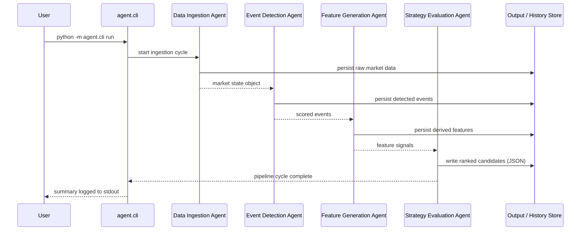

# Energy Options Opportunity Agent — User Guide

> **Version 1.0 • March 2026**
> This guide walks you through installing, configuring, and running the full four-agent pipeline end-to-end.

---

## Table of Contents

1. [Overview](#overview)
2. [Prerequisites](#prerequisites)
3. [Setup & Configuration](#setup--configuration)
4. [Running the Pipeline](#running-the-pipeline)
5. [Interpreting the Output](#interpreting-the-output)
6. [Troubleshooting](#troubleshooting)

---

## Overview

The **Energy Options Opportunity Agent** is an autonomous, modular Python pipeline that identifies options trading opportunities driven by oil market instability. It ingests market data, supply signals, news events, and alternative datasets, then produces structured, ranked candidate options strategies with full signal explainability.

### Pipeline Architecture

The system is composed of four loosely coupled agents that communicate via a shared **market state object** and a **derived features store**. Data flows strictly in one direction.

```mermaid
flowchart LR
    subgraph Ingestion["① Data Ingestion Agent"]
        A1[Crude Prices\nAlpha Vantage / MetalpriceAPI]
        A2[ETF & Equity Prices\nyfinance / Yahoo Finance]
        A3[Options Chains\nYahoo Finance / Polygon.io]
    end

    subgraph Events["② Event Detection Agent"]
        B1[News & Geo Events\nGDELT / NewsAPI]
        B2[Supply & Inventory\nEIA API]
        B3[Shipping & Logistics\nMarineTraffic / VesselFinder]
    end

    subgraph Features["③ Feature Generation Agent"]
        C1[Volatility Gap\nRealized vs Implied]
        C2[Futures Curve Steepness]
        C3[Sector Dispersion]
        C4[Insider Conviction Score]
        C5[Narrative Velocity]
        C6[Supply Shock Probability]
    end

    subgraph Strategy["④ Strategy Evaluation Agent"]
        D1[Long Straddles]
        D2[Call / Put Spreads]
        D3[Calendar Spreads]
    end

    OUTPUT[("Ranked Candidates\nJSON Output")]

    Ingestion -->|market state object| Events
    Events -->|scored events| Features
    Features -->|derived signals| Strategy
    Strategy -->|edge-scored candidates| OUTPUT
```



### In-Scope Instruments & Structures

| Category | Items |
|---|---|
| **Crude futures** | Brent Crude, WTI |
| **ETFs** | USO, XLE |
| **Energy equities** | Exxon Mobil (XOM), Chevron (CVX) |
| **Option structures (MVP)** | Long straddles, call/put spreads, calendar spreads |

> **Advisory only.** The system makes no trades. All output is for informational and analytical purposes.

---

## Prerequisites

### System Requirements

| Requirement | Minimum |
|---|---|
| Python | 3.10 or later |
| Operating system | Linux, macOS, or Windows (WSL2 recommended) |
| RAM | 2 GB |
| Disk space | 10 GB (for 6–12 months of historical data) |
| Deployment target | Local machine, single VM, or container |

### Required CLI Tools

```bash
# Verify Python version
python --version   # must be ≥ 3.10

# Verify pip
pip --version

# Optional but recommended: virtual environment tooling
python -m venv --help
```

### API Accounts

Register for free-tier accounts at each provider before configuring the pipeline.

| Data Layer | Provider | Cost | Sign-up URL |
|---|---|---|---|
| Crude prices | Alpha Vantage | Free | https://www.alphavantage.co |
| Crude prices (alt) | MetalpriceAPI | Free | https://metalpriceapi.com |
| ETF / equity prices | Yahoo Finance via `yfinance` | Free | *(no key required)* |
| Options chains | Polygon.io | Free / Limited | https://polygon.io |
| Supply & inventory | EIA API | Free | https://www.eia.gov/opendata |
| News & geo events | NewsAPI | Free | https://newsapi.org |
| News & geo events (alt) | GDELT | Free | https://www.gdeltproject.org |
| Insider activity | SEC EDGAR | Free | https://efts.sec.gov/LATEST/search-index |
| Insider activity (alt) | Quiver Quant | Free / Limited | https://www.quiverquant.com |
| Shipping & logistics | MarineTraffic | Free tier | https://www.marinetraffic.com |
| Narrative / sentiment | Reddit API | Free | https://www.reddit.com/prefs/apps |

---

## Setup & Configuration

### 1. Clone the Repository

```bash
git clone https://github.com/your-org/energy-options-agent.git
cd energy-options-agent
```

### 2. Create and Activate a Virtual Environment

```bash
python -m venv .venv

# macOS / Linux
source .venv/bin/activate

# Windows (PowerShell)
.venv\Scripts\Activate.ps1
```

### 3. Install Dependencies

```bash
pip install --upgrade pip
pip install -r requirements.txt
```

### 4. Configure Environment Variables

The pipeline reads all secrets and runtime settings from environment variables. Copy the provided template and populate each value.

```bash
cp .env.example .env
```

Open `.env` in your editor and fill in the values described in the table below.

#### Environment Variable Reference

| Variable | Required | Description | Example |
|---|---|---|---|
| `ALPHA_VANTAGE_API_KEY` | Yes | API key for crude spot/futures prices | `ABC123XYZ` |
| `METALPRICE_API_KEY` | No | Fallback key for crude prices | `DEF456` |
| `POLYGON_API_KEY` | Yes | Options chain data (strike, expiry, IV, volume) | `pK_live_...` |
| `EIA_API_KEY` | Yes | Weekly inventory and refinery utilization | `a1b2c3d4e5` |
| `NEWS_API_KEY` | Yes | News and geopolitical event feed | `nk_live_...` |
| `REDDIT_CLIENT_ID` | No | Reddit API client ID for sentiment velocity | `rABC123` |
| `REDDIT_CLIENT_SECRET` | No | Reddit API client secret | `secret_xyz` |
| `REDDIT_USER_AGENT` | No | Reddit API user-agent string | `energy-agent/1.0` |
| `QUIVER_QUANT_API_KEY` | No | Insider conviction scores (alternative to EDGAR) | `qk_...` |
| `MARINE_TRAFFIC_API_KEY` | No | Tanker flow and shipping disruption data | `mt_...` |
| `OUTPUT_DIR` | Yes | Directory where JSON output files are written | `./output` |
| `HISTORY_DIR` | Yes | Directory for persisted raw and derived data | `./data/history` |
| `HISTORY_RETENTION_DAYS` | No | Days of history to retain (default: `365`) | `180` |
| `MARKET_DATA_POLL_INTERVAL_SECONDS` | No | Refresh cadence for minute-level feeds (default: `60`) | `120` |
| `LOG_LEVEL` | No | Logging verbosity: `DEBUG`, `INFO`, `WARNING`, `ERROR` | `INFO` |
| `PIPELINE_PHASE` | No | Active MVP phase: `1`, `2`, `3`, or `4` (default: `1`) | `2` |

> **Tip:** Variables marked **No** are optional for the current MVP phase. Phase 1 does not require shipping or sentiment credentials. See [MVP Phasing](#mvp-phasing-and-pipeline_phase) for details.

#### Example `.env` File

```dotenv
# --- Crude Prices ---
ALPHA_VANTAGE_API_KEY=your_alpha_vantage_key
METALPRICE_API_KEY=your_metalprice_key

# --- Options & Equity ---
POLYGON_API_KEY=your_polygon_key

# --- Supply & Inventory ---
EIA_API_KEY=your_eia_key

# --- News & Events ---
NEWS_API_KEY=your_newsapi_key

# --- Alternative / Contextual Signals (Phase 3+) ---
REDDIT_CLIENT_ID=your_reddit_client_id
REDDIT_CLIENT_SECRET=your_reddit_client_secret
REDDIT_USER_AGENT=energy-options-agent/1.0

QUIVER_QUANT_API_KEY=your_quiver_key
MARINE_TRAFFIC_API_KEY=your_mt_key

# --- Storage ---
OUTPUT_DIR=./output
HISTORY_DIR=./data/history
HISTORY_RETENTION_DAYS=365

# --- Runtime ---
MARKET_DATA_POLL_INTERVAL_SECONDS=60
LOG_LEVEL=INFO
PIPELINE_PHASE=1
```

### 5. Initialise Storage Directories

```bash
python -m agent.cli init
```

This command creates the `OUTPUT_DIR` and `HISTORY_DIR` directories defined in your `.env`, validates that all required API keys for the active `PIPELINE_PHASE` are present, and writes a `health_check.json` to `OUTPUT_DIR`.

---

## Running the Pipeline

### Pipeline Execution Flow



### Single Cycle (One-Shot)

Run the full pipeline once and exit. Useful for testing and scheduled jobs (e.g., cron).

```bash
python -m agent.cli run --once
```

### Continuous Mode

Run the pipeline on a loop, refreshing market-level data at the cadence set by `MARKET_DATA_POLL_INTERVAL_SECONDS`.

```bash
python -m agent.cli run
```

Press `Ctrl+C` to stop gracefully. The pipeline completes the current cycle before exiting.

### Run a Specific Agent Only

Each agent can be invoked independently, which is useful for debugging or incremental development.

```bash
# Data Ingestion Agent only
python -m agent.cli run --agent ingestion

# Event Detection Agent only
python -m agent.cli run --agent events

# Feature Generation Agent only
python -m agent.cli run --agent features

# Strategy Evaluation Agent only
python -m agent.cli run --agent strategy
```

> **Note:** Running downstream agents in isolation requires that upstream artifacts already exist in `HISTORY_DIR` from a prior full run or partial run.

### Run with a Specific MVP Phase

Override the phase set in `.env` at the command line:

```bash
python -m agent.cli run --once --phase 2
```

#### MVP Phasing and `PIPELINE_PHASE`

| Phase | Name | Data Sources Active | Structures Available |
|---|---|---|---|
| `1` | Core Market Signals & Options | Alpha Vantage, yfinance, Polygon.io | Long straddles, call/put spreads |
| `2` | Supply & Event Augmentation | Phase 1 + EIA, GDELT/NewsAPI | Phase 1 + event-driven edge scoring |
| `3` | Alternative / Contextual Signals | Phase 2 + EDGAR/Quiver, Reddit, MarineTraffic | Phase 2 + calendar spreads, full edge model |
| `4` | High-Fidelity Enhancements | Phase 3 + optional paid feeds | Expanded structures (deferred; see below) |

> **Phase 4 note:** Exotic or multi-legged structures (iron condors, butterflies), regional OPIS pricing, and automated execution integration are explicitly out of scope for the MVP and are not enabled by any current flag.

### Viewing Logs

Logs are written to `stdout` and to `./logs/agent.log`. Adjust verbosity with `LOG_LEVEL`.

```bash
# Follow live log output
tail -f ./logs/agent.log

# Filter for warnings and above
grep -E "WARNING|ERROR" ./logs/agent.log
```

---

## Interpreting the Output

### Output Location

Each pipeline cycle writes a timestamped JSON file to `OUTPUT_DIR`:

```
./output/
└── candidates_2026-03-15T14:32:00Z.json
```

A symlink `./output/latest.json` always points to the most recent file.

### Output Schema

Each element in the output array represents one ranked strategy candidate.

| Field | Type | Description |
|---|---|---|
| `instrument` | `string` | Target instrument, e.g. `"USO"`, `"XLE"`, `"CL=F"` |
| `structure` | `enum` | `long_straddle` \| `call_spread` \| `put_spread` \| `calendar_spread` |
| `expiration` | `integer` | Target expiration in calendar days from evaluation date |
| `edge_score` | `float [0.0–1.0]` | Composite opportunity score; higher = stronger signal confluence |
| `signals` | `object` | Map of contributing signal names to their assessed values |
| `generated_at` | `ISO 8601 datetime` | UTC timestamp of candidate generation |

### Example Output File

```json
[
  {
    "instrument": "USO",
    "structure": "long_straddle",
    "expiration": 30,
    "edge_score": 0.47,
    "signals": {
      "tanker_disruption_index": "high",
      "volatility_gap": "positive",
      "narrative_velocity": "rising"
    },
    "generated_at": "2026-03-15T14:32:00Z"
  },
  {
    "instrument": "XOM",
    "structure": "call_spread",
    "expiration": 21,
    "edge_score": 0.31,
    "signals": {
      "volatility_gap": "positive",
      "supply_shock_probability": "elevated",
      "insider_conviction_score": "moderate"
    },
    "generated_at": "2026-03-15T14:32:00Z"
  }
]
```

### Reading the Edge Score

| `edge_score` Range | Interpretation |
|---|---|
| `0.70 – 1.00` | Strong signal confluence; high-priority candidate |
| `0.45 – 0.69` | Moderate confluence; warrants further review |
| `0.20 – 0.44` | Weak confluence; low-priority or noisy signal mix |
| `0.00 – 0.19` | Minimal signal support; unlikely to warrant action |

> **Important:** The edge score is a heuristic composite, not a probability of profit. It reflects the degree to which multiple independent signals align. Always apply your own risk management criteria before acting on any candidate.

### Reading the Signals Map

The `signals` object references the derived features produced by the Feature Generation Agent. Use it to understand *why* a candidate was surfaced.

| Signal Key | Source Agent | What it Measures |
|---|---|---|
| `volatility_gap` | Feature Generation | Gap between realized and implied volatility |
| `futures_curve_steepness` | Feature Generation | Contango or backwardation magnitude |
| `sector_dispersion` | Feature Generation | Cross-sector price divergence |
| `insider_conviction_score` | Feature Generation | Aggregated executive trading activity |
| `narrative_velocity` | Feature Generation | Headline acceleration / retail sentiment momentum |
| `supply_shock_probability` | Feature Generation | Estimated likelihood of a supply disruption event |
| `tanker_disruption_index` | Event Detection | Shipping