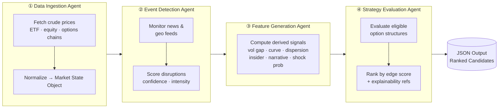

# Energy Options Opportunity Agent — User Guide

> **Version 1.0 · March 2026**
> This guide walks a developer through installing, configuring, and running the full four-agent pipeline end-to-end.

---

## Table of Contents

1. [Overview](#overview)
2. [Prerequisites](#prerequisites)
3. [Setup & Configuration](#setup--configuration)
4. [Running the Pipeline](#running-the-pipeline)
5. [Interpreting the Output](#interpreting-the-output)
6. [Troubleshooting](#troubleshooting)

---

## Overview

The **Energy Options Opportunity Agent** is a modular Python pipeline that identifies options trading opportunities driven by oil market instability. It ingests market data, supply signals, news events, and alternative datasets, then produces structured, ranked candidate options strategies with full explainability.

The pipeline is composed of four loosely coupled agents that execute in sequence:



### In-scope instruments

| Category | Instruments |
|---|---|
| Crude futures | Brent Crude, WTI (`CL=F`) |
| ETFs | USO, XLE |
| Energy equities | Exxon Mobil (XOM), Chevron (CVX) |

### In-scope option structures (MVP)

| Structure | Enum value |
|---|---|
| Long straddle | `long_straddle` |
| Call spread | `call_spread` |
| Put spread | `put_spread` |
| Calendar spread | `calendar_spread` |

> **Advisory only.** The system surfaces ranked opportunities; it does **not** execute trades automatically.

---

## Prerequisites

### Software

| Requirement | Minimum version | Notes |
|---|---|---|
| Python | 3.10 | 3.11+ recommended |
| pip | 22.x | or use `pipenv` / `poetry` |
| Git | any recent | for cloning the repo |
| Docker *(optional)* | 20.x | for containerised deployment |

### API accounts

Obtain credentials for every data source the pipeline needs before running. All tiers listed below are free or have a free tier sufficient for MVP operation.

| Data layer | Source | Signup URL | Credential type |
|---|---|---|---|
| Crude prices | Alpha Vantage | `https://www.alphavantage.co` | API key |
| ETF / equity prices | Yahoo Finance (`yfinance`) | no account needed | — |
| Options chains | Polygon.io | `https://polygon.io` | API key |
| Supply & inventory | EIA API | `https://www.eia.gov/opendata` | API key |
| News & geo events | NewsAPI | `https://newsapi.org` | API key |
| News & geo events | GDELT | no account needed | — |
| Insider activity | SEC EDGAR | no account needed | — |
| Insider activity | Quiver Quant *(optional)* | `https://www.quiverquant.com` | API key |
| Shipping / logistics | MarineTraffic / VesselFinder | `https://www.marinetraffic.com` | API key (free tier) |
| Narrative / sentiment | Reddit | `https://www.reddit.com/prefs/apps` | Client ID + secret |
| Narrative / sentiment | Stocktwits | no key needed for public feed | — |

> **Phased integration.** Phase 1 only requires Alpha Vantage, `yfinance`, and Polygon.io. Additional credentials become necessary in Phases 2–3. See [MVP Phasing](#mvp-phasing-reference) below.

---

## Setup & Configuration

### 1. Clone the repository

```bash
git clone https://github.com/your-org/energy-options-agent.git
cd energy-options-agent
```

### 2. Create and activate a virtual environment

```bash
python -m venv .venv
source .venv/bin/activate        # macOS / Linux
.venv\Scripts\activate           # Windows PowerShell
```

### 3. Install dependencies

```bash
pip install --upgrade pip
pip install -r requirements.txt
```

### 4. Configure environment variables

Copy the provided template and populate your credentials:

```bash
cp .env.example .env
```

Open `.env` in your editor and fill in every value relevant to your current phase. The full variable reference is below.

#### Environment variable reference

| Variable | Required | Phase | Description |
|---|---|---|---|
| `ALPHA_VANTAGE_API_KEY` | Yes | 1 | API key for WTI / Brent spot & futures prices |
| `POLYGON_API_KEY` | Yes | 1 | API key for options chains (strike, expiry, IV, volume) |
| `EIA_API_KEY` | Yes | 2 | API key for weekly inventory & refinery utilization data |
| `NEWSAPI_KEY` | Yes | 2 | API key for energy disruption and geopolitical headlines |
| `QUIVER_QUANT_API_KEY` | Optional | 3 | API key for parsed insider-trade data from EDGAR |
| `MARINETRAFFIC_API_KEY` | Optional | 3 | API key for tanker flow / shipping logistics data |
| `REDDIT_CLIENT_ID` | Optional | 3 | OAuth client ID for Reddit sentiment ingestion |
| `REDDIT_CLIENT_SECRET` | Optional | 3 | OAuth client secret for Reddit sentiment ingestion |
| `DATA_RETENTION_DAYS` | No | all | Days of historical data to retain (default: `180`; range: 180–365) |
| `MARKET_REFRESH_CADENCE_SECONDS` | No | all | Polling interval for minutes-level market feeds (default: `60`) |
| `OUTPUT_DIR` | No | all | Directory for JSON output files (default: `./output`) |
| `LOG_LEVEL` | No | all | Python logging level: `DEBUG`, `INFO`, `WARNING`, `ERROR` (default: `INFO`) |

> **Security.** Never commit `.env` to version control. The provided `.gitignore` already excludes it.

### 5. Initialise the data store

The pipeline persists raw and derived data locally for backtesting support (6–12 months retention). Run the initialisation script once before the first pipeline execution:

```bash
python -m agent.cli init-store
```

Expected output:

```
[INFO] Data store initialised at ./data/
[INFO] Retention policy set to 180 days
[INFO] Schema version: 1.0
```

### MVP phasing reference

Run only the agents that match your current phase. Use the `--phase` flag (see [Running the Pipeline](#running-the-pipeline)) to restrict agent execution automatically.

| Phase | Name | Agents active | Additional credentials needed |
|---|---|---|---|
| 1 | Core Market Signals & Options | Ingestion, Strategy | Alpha Vantage, Polygon |
| 2 | Supply & Event Augmentation | + Event Detection | EIA, NewsAPI |
| 3 | Alternative / Contextual Signals | + Feature Generation (full) | Quiver Quant, MarineTraffic, Reddit |
| 4 | High-Fidelity Enhancements | all + optional integrations | OPIS *(paid)*, broker API |

---

## Running the Pipeline

### Full pipeline (all four agents, single pass)

```bash
python -m agent.cli run
```

This executes agents in the fixed order: **Ingestion → Event Detection → Feature Generation → Strategy Evaluation**, then writes ranked candidates to `$OUTPUT_DIR/candidates_<timestamp>.json`.

### Phase-restricted run

```bash
# Phase 1 only — no event detection or alternative signals
python -m agent.cli run --phase 1

# Phase 2 — adds event detection and EIA supply signals
python -m agent.cli run --phase 2
```

### Run a single agent

Each agent can be invoked independently for testing or incremental updates:

```bash
python -m agent.cli run-agent ingestion
python -m agent.cli run-agent event-detection
python -m agent.cli run-agent feature-generation
python -m agent.cli run-agent strategy-evaluation
```

> When running agents individually, ensure the upstream agent has already written its output to the shared market state store; otherwise the downstream agent will log a warning and operate on stale data.

### Continuous (scheduled) mode

To poll on the configured cadence (default: every 60 seconds for market feeds, daily for EIA/EDGAR):

```bash
python -m agent.cli run --continuous
```

Stop with `Ctrl+C`. The pipeline handles `SIGTERM` gracefully and flushes any in-progress write before exiting.

### Docker (optional)

```bash
# Build the image
docker build -t energy-options-agent:1.0 .

# Run with your local .env file
docker run --env-file .env \
           -v "$(pwd)/output:/app/output" \
           -v "$(pwd)/data:/app/data" \
           energy-options-agent:1.0
```

### Command summary

| Command | Description |
|---|---|
| `python -m agent.cli init-store` | Initialise local data store (run once) |
| `python -m agent.cli run` | Full pipeline, single pass |
| `python -m agent.cli run --phase <1-3>` | Phase-restricted single pass |
| `python -m agent.cli run --continuous` | Continuous polling mode |
| `python -m agent.cli run-agent <name>` | Execute one agent in isolation |
| `python -m agent.cli validate-config` | Check env vars and API connectivity |

---

## Interpreting the Output

### Output location

Each pipeline run writes a JSON file to `$OUTPUT_DIR` (default `./output/`):

```
output/
└── candidates_2026-03-15T14:32:07Z.json
```

### Output schema

Every entry in the output array represents one ranked strategy candidate:

| Field | Type | Description |
|---|---|---|
| `instrument` | `string` | Target instrument, e.g. `"USO"`, `"XLE"`, `"CL=F"` |
| `structure` | `enum` | `long_straddle` · `call_spread` · `put_spread` · `calendar_spread` |
| `expiration` | `integer` | Target expiration in calendar days from evaluation date |
| `edge_score` | `float [0.0–1.0]` | Composite opportunity score; higher = stronger signal confluence |
| `signals` | `object` | Map of contributing signals and their qualitative values |
| `generated_at` | `ISO 8601 datetime` | UTC timestamp of candidate generation |

### Example output

```json
[
  {
    "instrument": "USO",
    "structure": "long_straddle",
    "expiration": 30,
    "edge_score": 0.47,
    "signals": {
      "tanker_disruption_index": "high",
      "volatility_gap": "positive",
      "narrative_velocity": "rising"
    },
    "generated_at": "2026-03-15T14:32:07Z"
  },
  {
    "instrument": "XLE",
    "structure": "call_spread",
    "expiration": 21,
    "edge_score": 0.31,
    "signals": {
      "volatility_gap": "positive",
      "supply_shock_probability": "elevated",
      "sector_dispersion": "widening"
    },
    "generated_at": "2026-03-15T14:32:07Z"
  }
]
```

### Reading the edge score

| `edge_score` range | Interpretation |
|---|---|
| `0.70 – 1.00` | Strong signal confluence — multiple independent signals aligned |
| `0.40 – 0.69` | Moderate opportunity — review contributing signals before acting |
| `0.20 – 0.39` | Weak signal — treat as watchlist candidate only |
| `0.00 – 0.19` | Insufficient confluence — not actionable under current MVP logic |

> Candidates are sorted descending by `edge_score`. The top of the array represents the highest-priority opportunity at evaluation time.

### Reading the signals map

Each key in `signals` maps to a qualitative level. The table below lists all signals the pipeline can emit and their possible values:

| Signal key | Possible values | Source agent |
|---|---|---|
| `volatility_gap` | `positive` · `neutral` · `negative` | Feature Generation |
| `futures_curve_steepness` | `steep` · `flat` · `inverted` | Feature Generation |
| `sector_dispersion` | `widening` · `stable` · `narrowing` | Feature Generation |
| `insider_conviction_score` | `high` · `medium` · `low` | Feature Generation |
| `narrative_velocity` | `rising` · `stable` · `falling` | Feature Generation |
| `supply_shock_probability` | `elevated` · `moderate` · `low` | Feature Generation |
| `tanker_disruption_index` | `high` · `medium` · `low` | Event Detection |
| `refinery_outage_flag` | `active` · `none` | Event Detection |
| `geopolitical_event_score` | `high` · `medium` · `low` | Event Detection |

### Consuming output in thinkorswim or a dashboard

The JSON array is compatible with any JSON-capable visualization tool. For thinkorswim, import the file via the **Scan → Load from file** workflow, or pipe the output into a local dashboard by pointing it at the `$OUTPUT_DIR` path.

---

## Troubleshooting

### General diagnostics

Always run the config validator first when something is broken:

```bash
python -m agent.cli validate-config
```

This checks that all required environment variables are set and that each configured API endpoint is reachable.

### Common issues

| Symptom | Likely cause | Resolution |
|---|---|---|
| `KeyError: 'ALPHA_VANTAGE_API_KEY'` | Variable missing from `.env` | Add the key to `.env`; confirm `.env` is in the project root |
| `ConnectionError` on startup | API endpoint unreachable or key invalid | Run `validate-config`; check key expiry and network access |
| Output file is empty (`[]`) | No candidates met minimum scoring threshold | Check `LOG_LEVEL=DEBUG` output for signal values; confirm market hours |
| Agent exits with `StaleDataWarning` | Upstream agent output is missing or outdated | Run agents in order: `ingestion` → `event-detection` → `feature-generation` → `strategy-evaluation` |
| `PermissionError` writing to `./output` | Output directory not writable | `mkdir -p output && chmod 755 output` or set `OUTPUT_DIR` to a writable path |
| EIA data not refreshing | EIA API only updates weekly | Expected behaviour — EIA feed cadence is weekly by design |
| Options chain data missing strikes | Polygon.io free tier rate limit hit | Add delay between requests; consider upgrading Polygon tier |
| Pipeline crashes on missing news feed | GDELT or NewsAPI temporarily unavailable | The pipeline is designed to tolerate delayed or missing feeds; a single failed source should log a warning and continue. If it crashes, check `LOG_LEVEL=DEBUG` for the specific agent raising the exception |
| Docker container exits immediately | `.env` not passed correctly | Confirm `--env-file .env` flag is present; verify file path |

### Enabling debug logging

```bash
# In .env
LOG_LEVEL=DEBUG

# Or inline for a single run
LOG_LEVEL=DEBUG python -m agent.cli run
```

Debug output includes per-agent timing, raw