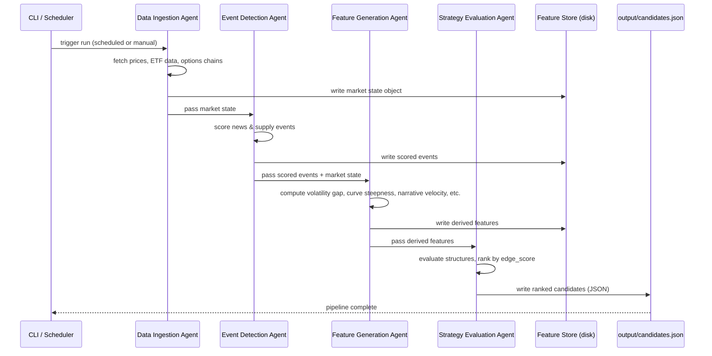

# Energy Options Opportunity Agent — User Guide

> **Version 1.0 · March 2026**
> This guide covers the full four-agent pipeline: from initial setup through running the system and interpreting its output.

---

## Table of Contents

1. [Overview](#overview)
2. [Prerequisites](#prerequisites)
3. [Setup & Configuration](#setup--configuration)
4. [Running the Pipeline](#running-the-pipeline)
5. [Interpreting the Output](#interpreting-the-output)
6. [Troubleshooting](#troubleshooting)

---

## Overview

The **Energy Options Opportunity Agent** is an autonomous, modular Python pipeline that identifies options trading opportunities driven by oil market instability. It ingests market data, supply signals, news events, and alternative datasets, then produces structured, ranked candidate options strategies.

### What the pipeline does

```mermaid
flowchart LR
    subgraph Ingestion["① Data Ingestion Agent"]
        A1[Crude Prices\nWTI · Brent]
        A2[ETF / Equity Prices\nUSO · XLE · XOM · CVX]
        A3[Options Chains\nIV · Strike · Volume]
    end

    subgraph Event["② Event Detection Agent"]
        B1[News & Geo Feeds\nGDELT · NewsAPI]
        B2[Supply Signals\nEIA · MarineTraffic]
        B3[Confidence &\nIntensity Scoring]
    end

    subgraph Feature["③ Feature Generation Agent"]
        C1[Volatility Gap\nRealised vs Implied]
        C2[Futures Curve\nSteepness]
        C3[Narrative Velocity\nInsider Conviction\nSupply Shock Prob.]
    end

    subgraph Strategy["④ Strategy Evaluation Agent"]
        D1[Eligible Structures\nStraddle · Spreads]
        D2[Edge Score\nRanking]
        D3[JSON Output\nExplainability Refs]
    end

    Ingestion -->|market state object| Event
    Event -->|scored events| Feature
    Feature -->|derived features store| Strategy
    Strategy -->|ranked candidates| Output[(output.json)]
```



### In-scope instruments and structures

| Category | Items |
|---|---|
| Crude futures | Brent Crude, WTI (`CL=F`) |
| ETFs | USO, XLE |
| Energy equities | XOM (ExxonMobil), CVX (Chevron) |
| Option structures (MVP) | Long straddles, call/put spreads, calendar spreads |

> **Advisory only.** The system surfaces ranked opportunities; it does **not** execute trades automatically.

---

## Prerequisites

### System requirements

| Requirement | Minimum |
|---|---|
| Python | 3.10 or later |
| OS | Linux, macOS, or Windows (WSL2 recommended) |
| RAM | 2 GB |
| Disk | 10 GB (for 6–12 months of historical data) |
| Network | Outbound HTTPS access to data provider APIs |

### Python dependencies

Install dependencies from the project root:

```bash
pip install -r requirements.txt
```

Key packages the pipeline relies on (representative, not exhaustive):

| Package | Purpose |
|---|---|
| `yfinance` | ETF / equity / options chain data |
| `requests` | REST calls to Alpha Vantage, EIA, GDELT, SEC EDGAR |
| `pandas` / `numpy` | Data normalisation and feature computation |
| `pydantic` | Market state object validation and serialisation |
| `apscheduler` | Scheduled polling (minutes-level and daily cadences) |

### External API accounts

All required data sources are free or free-tier. Register for credentials before running the pipeline:

| Source | URL | Notes |
|---|---|---|
| Alpha Vantage | https://www.alphavantage.co/support/#api-key | WTI / Brent spot prices |
| EIA Open Data | https://www.eia.gov/opendata/ | Inventory & refinery utilisation |
| NewsAPI | https://newsapi.org/register | Energy news headlines |
| Polygon.io | https://polygon.io/ | Options chain data (free tier) |
| Quiver Quant | https://www.quiverquant.com/ | Insider / EDGAR activity |

> GDELT, Yahoo Finance (`yfinance`), SEC EDGAR, MarineTraffic free tier, Reddit, and Stocktwits do **not** require API keys for basic access.

---

## Setup & Configuration

### 1. Clone the repository

```bash
git clone https://github.com/your-org/energy-options-agent.git
cd energy-options-agent
```

### 2. Create and activate a virtual environment

```bash
python -m venv .venv
source .venv/bin/activate        # Linux / macOS
# .venv\Scripts\activate         # Windows PowerShell
```

### 3. Install dependencies

```bash
pip install -r requirements.txt
```

### 4. Configure environment variables

Copy the provided template and populate your credentials:

```bash
cp .env.example .env
```

Open `.env` in your editor and fill in each value. The table below describes every variable the pipeline reads.

#### Environment variable reference

| Variable | Required | Default | Description |
|---|---|---|---|
| `ALPHA_VANTAGE_API_KEY` | ✅ | — | API key for crude price feeds (WTI, Brent) |
| `EIA_API_KEY` | ✅ | — | API key for EIA inventory and refinery data |
| `NEWSAPI_KEY` | ✅ | — | API key for NewsAPI geopolitical/energy headlines |
| `POLYGON_API_KEY` | ✅ | — | API key for Polygon.io options chain data |
| `QUIVER_API_KEY` | ⬜ | — | API key for Quiver Quant insider trades (Phase 3) |
| `PRICE_REFRESH_INTERVAL_SECONDS` | ⬜ | `60` | How often (seconds) the ingestion agent polls minute-level price feeds |
| `SLOW_FEED_CRON` | ⬜ | `0 6 * * *` | Cron expression for EIA / EDGAR daily refreshes |
| `HISTORICAL_RETENTION_DAYS` | ⬜ | `365` | Days of raw and derived data to retain for backtesting (180–365 recommended) |
| `OUTPUT_PATH` | ⬜ | `./output/candidates.json` | File path where ranked strategy candidates are written |
| `LOG_LEVEL` | ⬜ | `INFO` | Logging verbosity: `DEBUG`, `INFO`, `WARNING`, `ERROR` |
| `MIN_EDGE_SCORE` | ⬜ | `0.20` | Minimum `edge_score` threshold; candidates below this are excluded from output |
| `INSTRUMENTS` | ⬜ | `USO,XLE,XOM,CVX,CL=F` | Comma-separated list of instruments to evaluate |
| `OPTION_STRUCTURES` | ⬜ | `long_straddle,call_spread,put_spread,calendar_spread` | Comma-separated eligible option structures |
| `DATA_DIR` | ⬜ | `./data` | Root directory for persisted raw and derived data |

> **Security note:** Never commit `.env` to version control. The repository's `.gitignore` already excludes it.

### 5. Verify configuration

```bash
python -m agent.cli check-config
```

A successful check prints each agent's configuration status:

```
[✓] Data Ingestion Agent   — credentials OK, instruments: USO XLE XOM CVX CL=F
[✓] Event Detection Agent  — NewsAPI reachable, EIA reachable
[✓] Feature Generation Agent — data directory writable
[✓] Strategy Evaluation Agent — output path writable
```

Fix any `[✗]` entries before proceeding.

---

## Running the Pipeline

### Pipeline execution model



Data flows **unidirectionally** through each agent. Each agent reads from the shared feature store and appends its own outputs; agents are independently deployable and can be restarted without restarting the full pipeline.

### Running a full pipeline cycle manually

```bash
python -m agent.cli run
```

This triggers a single synchronous pass through all four agents and writes output to `OUTPUT_PATH`.

### Running with live scheduling (recommended for production use)

```bash
python -m agent.cli run --schedule
```

The scheduler runs:

- **Every `PRICE_REFRESH_INTERVAL_SECONDS`** — Data Ingestion Agent polls minute-level price feeds and triggers the downstream agents.
- **Daily at `SLOW_FEED_CRON`** — EIA inventory, SEC EDGAR insider data, and Quiver Quant feeds are refreshed.

Stop the scheduler with `Ctrl+C`; it flushes the current cycle before exiting.

### Running individual agents

Each agent can be invoked independently, which is useful during development or when debugging a specific layer:

```bash
# Data Ingestion only
python -m agent.cli run --agent ingestion

# Event Detection only (reads existing market state from DATA_DIR)
python -m agent.cli run --agent event-detection

# Feature Generation only
python -m agent.cli run --agent feature-generation

# Strategy Evaluation only (reads existing derived features from DATA_DIR)
python -m agent.cli run --agent strategy-evaluation
```

### Filtering output at run time

Pass overrides directly on the command line; these take precedence over `.env` values for that run:

```bash
# Only surface candidates with edge_score >= 0.40 on USO and XLE
python -m agent.cli run \
  --instruments USO,XLE \
  --min-edge-score 0.40

# Limit to long straddles only
python -m agent.cli run \
  --structures long_straddle
```

### Running in a container

A `Dockerfile` is provided for single-container deployment:

```bash
docker build -t energy-options-agent:latest .

docker run --rm \
  --env-file .env \
  -v "$(pwd)/data:/app/data" \
  -v "$(pwd)/output:/app/output" \
  energy-options-agent:latest \
  python -m agent.cli run --schedule
```

---

## Interpreting the Output

### Output file location

By default, ranked candidates are written to:

```
./output/candidates.json
```

Override with the `OUTPUT_PATH` environment variable.

### Output schema

Each candidate in the output array conforms to the following schema:

| Field | Type | Description |
|---|---|---|
| `instrument` | `string` | Target instrument, e.g. `"USO"`, `"XLE"`, `"CL=F"` |
| `structure` | `enum` | `long_straddle` \| `call_spread` \| `put_spread` \| `calendar_spread` |
| `expiration` | `integer` (days) | Target expiration in calendar days from evaluation date |
| `edge_score` | `float [0.0–1.0]` | Composite opportunity score; **higher = stronger signal confluence** |
| `signals` | `object` | Map of contributing signals and their qualitative value |
| `generated_at` | ISO 8601 datetime | UTC timestamp of candidate generation |

### Example output

```json
[
  {
    "instrument": "USO",
    "structure": "long_straddle",
    "expiration": 30,
    "edge_score": 0.47,
    "signals": {
      "tanker_disruption_index": "high",
      "volatility_gap": "positive",
      "narrative_velocity": "rising"
    },
    "generated_at": "2026-03-15T14:32:00Z"
  },
  {
    "instrument": "XLE",
    "structure": "call_spread",
    "expiration": 21,
    "edge_score": 0.31,
    "signals": {
      "volatility_gap": "positive",
      "supply_shock_probability": "elevated",
      "narrative_velocity": "stable"
    },
    "generated_at": "2026-03-15T14:32:00Z"
  }
]
```

### Understanding edge scores

| `edge_score` range | Interpretation |
|---|---|
| `0.70 – 1.00` | Strong signal confluence; high-priority candidate |
| `0.40 – 0.69` | Moderate confluence; worth monitoring |
| `0.20 – 0.39` | Weak confluence; treat as exploratory |
| `< 0.20` | Below threshold; excluded from output by default |

The edge score is a **composite heuristic** — it aggregates all active signals (volatility gap, event confidence/intensity, futures curve steepness, narrative velocity, insider conviction, supply shock probability, and sector dispersion). It is **not** a probability of profit; treat it as a relative ranking signal to focus your own due diligence.

### Understanding the `signals` map

Each key in the `signals` object corresponds to a derived feature computed by the Feature Generation Agent. Common signal keys and their meanings:

| Signal key | Source agent | What it measures |
|---|---|---|
| `volatility_gap` | Feature Generation | Realised IV vs. implied IV divergence; `positive` = implied underpriced |
| `futures_curve_steepness` | Feature Generation | Contango / backwardation severity |
| `supply_shock_probability` | Feature Generation | Probability of near-term supply disruption |
| `tanker_disruption_index` | Event Detection | Severity of shipping / chokepoint events from MarineTraffic / GDELT |
| `narrative_velocity` | Feature Generation | Rate of headline acceleration from NewsAPI / Reddit / Stocktwits |
| `insider_conviction_score` | Feature Generation | Directional conviction from SEC EDGAR / Quiver insider trades |
| `sector_dispersion` | Feature Generation | Energy equity cross-sector correlation divergence |
| `eia_inventory_signal` | Event Detection | EIA inventory draw/build vs. analyst expectations |

> **Explainability:** Every candidate's `signals` object contains **only the signals that contributed to its edge score**. A signal absent from the map had no material influence on that candidate's ranking.

### Visualising output in thinkorswim or other dashboards

The JSON output is compatible with any tool that can consume a JSON array. For thinkorswim:

1. Export `candidates.json` to a shared network path or cloud bucket accessible from your thinkorswim workstation.
2. Use thinkorswim's **thinkScript** watchlist or a custom gadget to load the JSON and display `instrument`, `structure`, `edge_score`, and `expiration` as columns.
3. Sort by `edge_score` descending to prioritise candidates.

---

## Troubleshooting

### General diagnostic command

```bash
python -m agent.cli diagnose
```

Prints connectivity status for every data source, file system permissions, and the current market state object summary.

### Common issues

| Symptom | Likely cause | Resolution |
|---|---|---|
| `[✗] ALPHA_VANTAGE_API_KEY missing` | Environment variable not set | Populate `.env` and re-source it: `source .env` or restart your shell |
| `output/candidates.json` is empty | All candidates below `MIN_EDGE