# Energy Options Opportunity Agent — User Guide

> **Version 1.0 · March 2026**
> This guide walks you through setting up, configuring, and running the full Energy Options Opportunity Agent pipeline. It is written for developers who are comfortable with Python and CLI tools but are new to this project.

---

## Table of Contents

1. [Overview](#overview)
2. [Prerequisites](#prerequisites)
3. [Setup & Configuration](#setup--configuration)
4. [Running the Pipeline](#running-the-pipeline)
5. [Interpreting the Output](#interpreting-the-output)
6. [Troubleshooting](#troubleshooting)

---

## Overview

The **Energy Options Opportunity Agent** is an autonomous, modular Python pipeline that identifies options trading opportunities driven by oil market instability. It ingests market data, supply signals, news events, and alternative datasets to produce structured, ranked candidate options strategies.

The system surfaces **volatility mispricing** in oil-related instruments, ranks candidates by a computed **edge score**, and maintains full **explainability** of every recommendation. It is designed for a single-contributor deployment with an emphasis on low-cost, zero-execution-risk operation — the pipeline is **advisory only**; no trades are placed automatically.

### Pipeline Architecture

The pipeline is composed of four loosely coupled agents that communicate through a shared **market state object** and a **derived features store**. Data flows strictly left to right:

```mermaid
flowchart LR
    subgraph Ingestion["① Data Ingestion Agent"]
        A1[Crude Prices\nAlpha Vantage / MetalpriceAPI]
        A2[ETF & Equity Prices\nyfinance / Yahoo Finance]
        A3[Options Chains\nYahoo Finance / Polygon.io]
        A4[Supply & Inventory\nEIA API]
    end

    subgraph EventDet["② Event Detection Agent"]
        B1[News & Geo Events\nGDELT / NewsAPI]
        B2[Shipping & Logistics\nMarineTraffic / VesselFinder]
        B3[Confidence & Intensity\nScoring]
    end

    subgraph FeatureGen["③ Feature Generation Agent"]
        C1[Volatility Gap\nRealized vs Implied]
        C2[Futures Curve Steepness]
        C3[Sector Dispersion]
        C4[Insider Conviction Score\nEDGAR / Quiver Quant]
        C5[Narrative Velocity\nReddit / Stocktwits]
        C6[Supply Shock Probability]
    end

    subgraph StratEval["④ Strategy Evaluation Agent"]
        D1[Eligible Structure\nEvaluation]
        D2[Edge Score Computation]
        D3[Ranked Candidates\nJSON Output]
    end

    Ingestion -->|market state object| EventDet
    EventDet -->|scored events| FeatureGen
    FeatureGen -->|derived features store| StratEval
    StratEval -->|candidates.json| Output[(Output\nDashboard / JSON)]
```



### In-Scope Instruments & Structures

| Category | Items |
|---|---|
| **Crude Futures** | Brent Crude, WTI |
| **ETFs** | USO, XLE |
| **Energy Equities** | Exxon Mobil (XOM), Chevron (CVX) |
| **Option Structures (MVP)** | Long straddles, call/put spreads, calendar spreads |

---

## Prerequisites

### System Requirements

| Requirement | Minimum |
|---|---|
| Python | 3.10 or later |
| Operating System | Linux, macOS, or Windows (WSL2 recommended on Windows) |
| RAM | 2 GB |
| Disk | 5 GB (grows with historical data retention; plan for 6–12 months) |
| Network | Outbound HTTPS to external APIs |

### External Accounts & API Keys

Register for the following free-tier services before proceeding. All are free or low-cost.

| Service | Purpose | Sign-up URL |
|---|---|---|
| Alpha Vantage | WTI / Brent spot & futures prices | https://www.alphavantage.co |
| MetalpriceAPI | Alternative crude price feed | https://metalpriceapi.com |
| Polygon.io | Options chain data (free tier) | https://polygon.io |
| EIA API | Inventory & refinery utilization | https://www.eia.gov/opendata |
| NewsAPI | News & geopolitical events | https://newsapi.org |
| GDELT | Geopolitical event stream | No key required (public) |
| Quiver Quant | Insider transaction data | https://www.quiverquant.com |
| MarineTraffic | Tanker flow data (free tier) | https://www.marinetraffic.com |

> **Note:** `yfinance` (Yahoo Finance) and Reddit (`praw`) do not require API keys for basic access but benefit from authenticated sessions for higher rate limits. GDELT is fully public and requires no credentials.

### Python Dependencies

```bash
pip install -r requirements.txt
```

A typical `requirements.txt` for the MVP includes:

```text
yfinance>=0.2
requests>=2.31
pandas>=2.0
numpy>=1.26
praw>=7.7          # Reddit sentiment
python-dotenv>=1.0
schedule>=1.2      # cadence management
```

---

## Setup & Configuration

### 1 — Clone the Repository

```bash
git clone https://github.com/your-org/energy-options-agent.git
cd energy-options-agent
```

### 2 — Create and Activate a Virtual Environment

```bash
python -m venv .venv
source .venv/bin/activate        # macOS / Linux
# .venv\Scripts\activate         # Windows PowerShell
```

### 3 — Install Dependencies

```bash
pip install --upgrade pip
pip install -r requirements.txt
```

### 4 — Configure Environment Variables

Copy the provided template and populate it with your API credentials:

```bash
cp .env.example .env
```

Open `.env` in your editor and fill in each value. The full list of recognised environment variables is shown below.

#### Environment Variable Reference

| Variable | Required | Default | Description |
|---|---|---|---|
| `ALPHA_VANTAGE_API_KEY` | ✅ Yes | — | API key for Alpha Vantage crude price feed |
| `METALPRICE_API_KEY` | ⬜ Optional | — | Fallback crude price feed (MetalpriceAPI) |
| `POLYGON_API_KEY` | ✅ Yes | — | Polygon.io key for options chain data |
| `EIA_API_KEY` | ✅ Yes | — | EIA Open Data key for inventory & refinery data |
| `NEWSAPI_KEY` | ✅ Yes | — | NewsAPI key for headline ingestion |
| `QUIVER_QUANT_API_KEY` | ⬜ Optional | — | Quiver Quant key for insider trade data (Phase 3) |
| `MARINETRAFFIC_API_KEY` | ⬜ Optional | — | MarineTraffic key for tanker flow data (Phase 3) |
| `REDDIT_CLIENT_ID` | ⬜ Optional | — | Reddit app client ID for `praw` (Phase 3) |
| `REDDIT_CLIENT_SECRET` | ⬜ Optional | — | Reddit app client secret for `praw` (Phase 3) |
| `REDDIT_USER_AGENT` | ⬜ Optional | `energy-agent/1.0` | User-agent string for Reddit requests |
| `OUTPUT_DIR` | ⬜ Optional | `./output` | Directory where JSON output files are written |
| `HISTORY_DIR` | ⬜ Optional | `./data/history` | Directory for persisted historical raw & derived data |
| `MARKET_DATA_INTERVAL_MINUTES` | ⬜ Optional | `5` | Polling cadence for minute-level market feeds |
| `SLOW_FEED_INTERVAL_HOURS` | ⬜ Optional | `24` | Polling cadence for daily/weekly feeds (EIA, EDGAR) |
| `LOG_LEVEL` | ⬜ Optional | `INFO` | Logging verbosity: `DEBUG`, `INFO`, `WARNING`, `ERROR` |
| `EDGE_SCORE_THRESHOLD` | ⬜ Optional | `0.30` | Minimum edge score for a candidate to appear in output |
| `MAX_EXPIRATION_DAYS` | ⬜ Optional | `90` | Upper bound on option expiration considered (calendar days) |
| `ENABLE_PHASE3_SIGNALS` | ⬜ Optional | `false` | Set to `true` to activate insider, shipping, and narrative signals |

#### Example `.env` File

```dotenv
# --- Required credentials ---
ALPHA_VANTAGE_API_KEY=your_alpha_vantage_key
POLYGON_API_KEY=your_polygon_key
EIA_API_KEY=your_eia_key
NEWSAPI_KEY=your_newsapi_key

# --- Optional / Phase 3 credentials ---
METALPRICE_API_KEY=
QUIVER_QUANT_API_KEY=
MARINETRAFFIC_API_KEY=
REDDIT_CLIENT_ID=
REDDIT_CLIENT_SECRET=
REDDIT_USER_AGENT=energy-agent/1.0

# --- Operational settings ---
OUTPUT_DIR=./output
HISTORY_DIR=./data/history
MARKET_DATA_INTERVAL_MINUTES=5
SLOW_FEED_INTERVAL_HOURS=24
LOG_LEVEL=INFO
EDGE_SCORE_THRESHOLD=0.30
MAX_EXPIRATION_DAYS=90
ENABLE_PHASE3_SIGNALS=false
```

### 5 — Initialise the Data Store

Run the initialisation script once to create the required directory structure and seed the historical data store:

```bash
python scripts/init_store.py
```

Expected output:

```
[INFO] Created directory: ./output
[INFO] Created directory: ./data/history/raw
[INFO] Created directory: ./data/history/derived
[INFO] Data store initialised successfully.
```

---

## Running the Pipeline

### Pipeline Execution Flow

```mermaid
sequenceDiagram
    participant CLI as User / Scheduler
    participant DIA as Data Ingestion Agent
    participant EDA as Event Detection Agent
    participant FGA as Feature Generation Agent
    participant SEA as Strategy Evaluation Agent
    participant FS as File System (JSON)

    CLI->>DIA: python run_pipeline.py
    DIA->>DIA: Fetch crude, ETF, equity,\noptions chain data
    DIA->>DIA: Normalise → market state object
    DIA->>EDA: market_state.json
    EDA->>EDA: Monitor news, geo, shipping feeds
    EDA->>EDA: Score events (confidence, intensity)
    EDA->>FGA: scored_events.json
    FGA->>FGA: Compute volatility gap, curve steepness,\ndispersion, insider score, narrative velocity,\nsupply shock probability
    FGA->>SEA: derived_features.json
    SEA->>SEA: Evaluate long straddles,\ncall/put spreads, calendar spreads
    SEA->>SEA: Compute edge scores; rank candidates
    SEA->>FS: candidates_<timestamp>.json
    FS-->>CLI: Pipeline complete — N candidates written
```

### Single Run (One-Shot)

Execute the full four-agent pipeline once and exit:

```bash
python run_pipeline.py
```

A successful run produces output similar to:

```
[INFO] Data Ingestion Agent  — fetching market data...
[INFO] Data Ingestion Agent  — market state object written (14 instruments)
[INFO] Event Detection Agent — scanning 3 feeds...
[INFO] Event Detection Agent — 4 events detected and scored
[INFO] Feature Generation    — computing 6 derived signals...
[INFO] Feature Generation    — derived features store updated
[INFO] Strategy Evaluation   — evaluating 3 option structures across 6 instruments...
[INFO] Strategy Evaluation   — 5 candidates above threshold (edge_score >= 0.30)
[INFO] Output written to: ./output/candidates_2026-03-15T09:32:00Z.json
[INFO] Pipeline complete.
```

### Continuous Mode (Scheduled)

To run the pipeline on a recurring cadence — market data every 5 minutes, slow feeds every 24 hours — use the built-in scheduler:

```bash
python run_pipeline.py --mode continuous
```

Override the default intervals at the command line:

```bash
python run_pipeline.py --mode continuous \
    --market-interval 10 \
    --slow-interval 48
```

To run as a background process on Linux:

```bash
nohup python run_pipeline.py --mode continuous > logs/pipeline.log 2>&1 &
echo $! > pipeline.pid
```

Stop it with:

```bash
kill $(cat pipeline.pid)
```

### Running Individual Agents

Each agent can be invoked independently for testing or incremental integration:

```bash
# Run only the Data Ingestion Agent
python -m agents.ingestion

# Run only the Event Detection Agent (reads existing market state)
python -m agents.event_detection

# Run only the Feature Generation Agent (reads existing scored events)
python -m agents.feature_generation

# Run only the Strategy Evaluation Agent (reads existing derived features)
python -m agents.strategy_evaluation
```

### CLI Reference

| Flag | Type | Default | Description |
|---|---|---|---|
| `--mode` | `once` \| `continuous` | `once` | Run once or on a recurring schedule |
| `--market-interval` | integer | `5` | Minutes between market-data refreshes (continuous mode) |
| `--slow-interval` | integer | `24` | Hours between slow-feed refreshes (continuous mode) |
| `--threshold` | float | `0.30` | Override `EDGE_SCORE_THRESHOLD` at runtime |
| `--output-dir` | path | `./output` | Override `OUTPUT_DIR` at runtime |
| `--log-level` | string | `INFO` | Override `LOG_LEVEL` at runtime |
| `--phase3` | flag | off | Enable Phase 3 signals (insider, shipping, narrative) |
| `--dry-run` | flag | off | Execute pipeline but do not write output files |

---

## Interpreting the Output

### Output File Location

Each pipeline run writes a timestamped JSON file to `OUTPUT_DIR`:

```
./output/candidates_2026-03-15T09:32:00Z.json
```

A symlink `./output/latest.json` always points to the most recently generated file.

### Output Schema

Each element in the output array represents a single ranked strategy candidate.

| Field | Type | Description |
|---|---|---|
| `instrument` | `string` | Target instrument — e.g. `"USO"`, `"XLE"`, `"CL=F"` (WTI) |
| `structure` | `enum` | Option structure: `long_straddle`, `call_spread`, `put_spread`, `calendar_spread` |
| `expiration` | `integer` | Target expiration in calendar days from the evaluation date |
| `edge_score` | `float [0.0–1.0]` | Composite opportunity score; higher = stronger signal confluence |
| `signals` | `object` | Map of contributing signals and their qualitative values |
| `generated_at` | `ISO 8601 datetime` | UTC timestamp of candidate generation |

### Example Output

```json
[
  {
    "instrument": "USO",
    "structure": "long_straddle",
    "expiration": 30,
    "edge_score": 0.47,
    "signals": {
      "tanker_disruption_index": "high",
      "volatility_gap": "positive",
      "narrative_velocity": "rising"
    },
    "generated_at": "2026-03-15T09:32:00Z"
  },
  {
    "instrument": "XOM",
    "structure": "call_spread",
    "expiration": 45,
    "edge_score": 0.38,
    "signals": {
      "volatility_gap": "positive",
      "supply_shock_probability": "elevated",
      "futures_curve_steepness": "backwardated