# Energy Options Opportunity Agent — User Guide

> **Version 1.0 · March 2026**
> This guide walks you through setting up, configuring, and running the full pipeline end-to-end. It assumes you are comfortable with Python 3 and basic CLI tooling but are new to this project.

---

## Table of Contents

1. [Overview](#overview)
2. [Prerequisites](#prerequisites)
3. [Setup & Configuration](#setup--configuration)
4. [Running the Pipeline](#running-the-pipeline)
5. [Interpreting the Output](#interpreting-the-output)
6. [Troubleshooting](#troubleshooting)

---

## Overview

The **Energy Options Opportunity Agent** is a four-agent Python pipeline that identifies options trading opportunities driven by oil market instability. It ingests market data, supply signals, news events, and alternative datasets, then produces structured, ranked strategy candidates—each with a computed **edge score** and full explainability of contributing signals.

> **Advisory only.** The system does not execute trades. All output is intended for human review, typically inside thinkorswim or any JSON-capable dashboard.

### Pipeline Architecture

Data flows unidirectionally through four loosely coupled agents that share a common market state object and a derived features store.

```mermaid
flowchart LR
    subgraph Sources["External Data Sources"]
        A1["Crude Prices\n(Alpha Vantage / MetalpriceAPI)"]
        A2["ETF & Equity Prices\n(yfinance / Yahoo Finance)"]
        A3["Options Chains\n(Yahoo Finance / Polygon.io)"]
        A4["Supply & Inventory\n(EIA API)"]
        A5["News & Geo Events\n(GDELT / NewsAPI)"]
        A6["Insider Activity\n(SEC EDGAR / Quiver Quant)"]
        A7["Shipping & Logistics\n(MarineTraffic / VesselFinder)"]
        A8["Narrative & Sentiment\n(Reddit / Stocktwits)"]
    end

    subgraph Pipeline["Agent Pipeline"]
        B["🔵 Data Ingestion Agent\nFetch & Normalize\n──────────────────\nUnified market state object\nHistorical data storage"]
        C["🟡 Event Detection Agent\nSupply & Geo Signals\n──────────────────\nDisruption detection\nConfidence / intensity scores"]
        D["🟠 Feature Generation Agent\nDerived Signal Computation\n──────────────────\nVolatility gaps · Curve steepness\nSector dispersion · Narrative velocity\nInsider conviction · Supply shock prob."]
        E["🟢 Strategy Evaluation Agent\nOpportunity Ranking\n──────────────────\nEdge score computation\nRanked candidate list\nExplainability references"]
    end

    subgraph Output["Output"]
        F["📄 JSON Candidates\n(ranked opportunities)"]
    end

    Sources --> B
    B --> C
    C --> D
    D --> E
    E --> F
```



### In-Scope Instruments & Strategies

| Category | Items |
|---|---|
| **Crude futures** | Brent Crude, WTI (`CL=F`) |
| **ETFs** | USO, XLE |
| **Energy equities** | Exxon Mobil (XOM), Chevron (CVX) |
| **Option structures (MVP)** | Long straddle, call spread, put spread, calendar spread |

---

## Prerequisites

### System Requirements

| Requirement | Minimum |
|---|---|
| Python | 3.10 or later |
| Operating system | Linux, macOS, or Windows (WSL recommended) |
| Hardware | Single VM or local machine (low-cost footprint) |
| Storage | Enough for 6–12 months of raw and derived data |
| Network | Outbound HTTPS access to all data source APIs |

### Python Dependencies

Install all dependencies into a virtual environment:

```bash
python -m venv .venv
source .venv/bin/activate          # Windows: .venv\Scripts\activate
pip install --upgrade pip
pip install -r requirements.txt
```

A representative `requirements.txt` includes (but is not limited to):

```text
yfinance
requests
pandas
numpy
python-dotenv
schedule
```

> Add `polygon-api-client`, `praw` (Reddit), or other SDK packages as you enable later pipeline phases.

### API Keys & Accounts

Before running the pipeline you must obtain credentials for each data source you intend to use. All sources are free or have a free tier.

| Data Source | Sign-up URL | Notes |
|---|---|---|
| Alpha Vantage | https://www.alphavantage.co | Free key; WTI/Brent spot & futures |
| MetalpriceAPI | https://metalpriceapi.com | Free tier alternative for crude prices |
| Polygon.io | https://polygon.io | Free tier; options chains |
| EIA API | https://www.eia.gov/opendata | Free; weekly inventory & refinery data |
| NewsAPI | https://newsapi.org | Free tier; energy news |
| GDELT | No key required | Public dataset; geopolitical events |
| SEC EDGAR | No key required | Public dataset; insider filings |
| Quiver Quant | https://www.quiverquant.com | Free/limited; insider conviction |
| MarineTraffic | https://www.marinetraffic.com | Free tier; tanker flows |
| VesselFinder | https://www.vesselfinder.com | Free tier alternative |
| Reddit (PRAW) | https://www.reddit.com/prefs/apps | Free; narrative/sentiment |
| Stocktwits | https://api.stocktwits.com | Free; retail sentiment velocity |

---

## Setup & Configuration

### 1. Clone the Repository

```bash
git clone https://github.com/your-org/energy-options-agent.git
cd energy-options-agent
```

### 2. Create the Environment File

Copy the provided template and populate your credentials:

```bash
cp .env.example .env
```

Open `.env` in your editor and fill in each value (see the full reference table below).

### Environment Variables Reference

| Variable | Required | Description | Example Value |
|---|---|---|---|
| `ALPHA_VANTAGE_API_KEY` | Yes (Phase 1) | Alpha Vantage API key for WTI/Brent prices | `ABCDE12345` |
| `METALPRICE_API_KEY` | Optional | Fallback crude price feed | `xyz987` |
| `POLYGON_API_KEY` | Optional | Polygon.io key for options chains | `pqr456` |
| `EIA_API_KEY` | Yes (Phase 2) | EIA Open Data API key for inventory data | `eia_abc123` |
| `NEWS_API_KEY` | Yes (Phase 2) | NewsAPI key for headline ingestion | `newskey789` |
| `QUIVER_API_KEY` | Optional (Phase 3) | Quiver Quant key for insider scores | `quiver_xyz` |
| `MARINETRAFFIC_API_KEY` | Optional (Phase 3) | MarineTraffic free-tier key | `mt_abc` |
| `REDDIT_CLIENT_ID` | Optional (Phase 3) | Reddit PRAW application client ID | `reddit_id` |
| `REDDIT_CLIENT_SECRET` | Optional (Phase 3) | Reddit PRAW application secret | `reddit_secret` |
| `REDDIT_USER_AGENT` | Optional (Phase 3) | PRAW user-agent string | `EnergyBot/1.0` |
| `STOCKTWITS_API_TOKEN` | Optional (Phase 3) | Stocktwits bearer token | `st_token_abc` |
| `DATA_DIR` | Yes | Local path for raw and derived data storage | `./data` |
| `OUTPUT_DIR` | Yes | Directory where JSON output is written | `./output` |
| `LOG_LEVEL` | No | Logging verbosity (`DEBUG`, `INFO`, `WARNING`) | `INFO` |
| `MARKET_REFRESH_INTERVAL_SECONDS` | No | Cadence for minute-level market data polls | `60` |
| `EIA_REFRESH_INTERVAL_HOURS` | No | Cadence for EIA weekly feed polling | `168` |
| `HISTORY_RETENTION_DAYS` | No | Days of historical data to retain | `365` |
| `EDGE_SCORE_THRESHOLD` | No | Minimum edge score to include in output | `0.20` |

### 3. Verify Configuration

```bash
python -m agent.config validate
```

Expected output on success:

```
[INFO] Configuration validated.
[INFO] DATA_DIR: ./data (writable ✓)
[INFO] OUTPUT_DIR: ./output (writable ✓)
[INFO] Required API keys present: ALPHA_VANTAGE_API_KEY, EIA_API_KEY, NEWS_API_KEY
[INFO] Optional keys detected: POLYGON_API_KEY, QUIVER_API_KEY
```

If a required variable is missing, the validator prints the offending key and exits with a non-zero status code.

---

## Running the Pipeline

### Pipeline Phases

The pipeline is phased. Enable only the phases you have data sources for. Each phase builds on the previous one.

| Phase | Name | Key additions |
|---|---|---|
| **1** | Core Market Signals & Options | WTI/Brent prices, USO/XLE, options surface, long straddles, call/put spreads |
| **2** | Supply & Event Augmentation | EIA inventory, GDELT/NewsAPI event detection, supply disruption indices |
| **3** | Alternative / Contextual Signals | Insider activity, narrative velocity, shipping data, full edge scoring |
| **4** | High-Fidelity Enhancements | Regional refined pricing, exotic structures, execution integration (deferred) |

### Running the Full Pipeline (Single Execution)

```bash
python -m agent.pipeline run --phase 1
```

To include Phase 2 signals (requires `EIA_API_KEY` and `NEWS_API_KEY`):

```bash
python -m agent.pipeline run --phase 2
```

To run all currently implemented phases:

```bash
python -m agent.pipeline run --phase 3
```

### Running the Pipeline on a Schedule

For continuous operation, use the built-in scheduler. Market-level data refreshes on a minutes cadence; slower feeds (EIA, EDGAR) refresh on daily/weekly schedules as configured.

```bash
python -m agent.pipeline schedule --phase 3
```

The scheduler respects `MARKET_REFRESH_INTERVAL_SECONDS` and `EIA_REFRESH_INTERVAL_HOURS` from your `.env`.

### Running Individual Agents

Each agent can be deployed and executed independently:

```bash
# 1. Data Ingestion Agent only
python -m agent.ingestion run

# 2. Event Detection Agent only (requires ingestion output)
python -m agent.events run

# 3. Feature Generation Agent only (requires ingestion + events output)
python -m agent.features run

# 4. Strategy Evaluation Agent only (requires all prior outputs)
python -m agent.strategy run
```

> **Tip:** Independent execution is useful during development or when debugging a single stage without re-running the full pipeline.

### Common CLI Flags

| Flag | Description |
|---|---|
| `--phase <1\|2\|3>` | Limit execution to signals available in that phase |
| `--dry-run` | Execute pipeline logic but do not write output files |
| `--output-dir <path>` | Override `OUTPUT_DIR` for this run |
| `--log-level <level>` | Override `LOG_LEVEL` for this run |
| `--instrument <ticker>` | Restrict evaluation to a single instrument (e.g. `USO`) |

Example:

```bash
python -m agent.pipeline run --phase 2 --dry-run --log-level DEBUG
```

---

## Interpreting the Output

### Output Location

After each pipeline run, ranked candidates are written to `OUTPUT_DIR` (default: `./output`) as a JSON file named with a UTC timestamp:

```
./output/candidates_2026-03-15T14-30-00Z.json
```

### Output Schema

Each element in the JSON array represents a single strategy candidate.

| Field | Type | Description |
|---|---|---|
| `instrument` | `string` | Target instrument (`USO`, `XLE`, `CL=F`, `XOM`, `CVX`) |
| `structure` | `enum` | Options structure: `long_straddle` \| `call_spread` \| `put_spread` \| `calendar_spread` |
| `expiration` | `integer` (days) | Target expiration in calendar days from evaluation date |
| `edge_score` | `float` [0.0–1.0] | Composite opportunity score; higher = stronger signal confluence |
| `signals` | `object` | Map of contributing signals and their qualitative state |
| `generated_at` | ISO 8601 datetime | UTC timestamp of candidate generation |

### Example Output

```json
[
  {
    "instrument": "USO",
    "structure": "long_straddle",
    "expiration": 30,
    "edge_score": 0.47,
    "signals": {
      "tanker_disruption_index": "high",
      "volatility_gap": "positive",
      "narrative_velocity": "rising"
    },
    "generated_at": "2026-03-15T14:30:00Z"
  },
  {
    "instrument": "XLE",
    "structure": "call_spread",
    "expiration": 45,
    "edge_score": 0.31,
    "signals": {
      "supply_shock_probability": "elevated",
      "futures_curve_steepness": "steep",
      "sector_dispersion": "high"
    },
    "generated_at": "2026-03-15T14:30:00Z"
  }
]
```

### Reading the Edge Score

| Edge Score Range | Interpretation |
|---|---|
| **0.70 – 1.00** | Strong signal confluence; high-priority candidate for review |
| **0.40 – 0.69** | Moderate confluence; worth monitoring |
| **0.20 – 0.39** | Weak signal; low conviction; treat with caution |
| **0.00 – 0.19** | Below threshold (filtered out by default via `EDGE_SCORE_THRESHOLD`) |

> Edge scores are heuristic composites in MVP. Do not treat them as probabilistic predictions of profit.

### Reading the Signals Map

Each key in the `signals` object corresponds to a derived feature computed by the Feature Generation Agent. Use this map to understand **why** a candidate was surfaced.

| Signal Key | Source Agent | What it Measures |
|---|---|---|
| `volatility_gap` | Feature Generation | Realized vs. implied volatility divergence |
| `futures_curve_steepness` | Feature Generation | Contango / backwardation in crude futures curve |
| `sector_dispersion` | Feature Generation | Spread between energy sub-sector returns |
| `insider_conviction_score` | Feature Generation | Executive trade activity from EDGAR/Quiver |
| `narrative_velocity` | Feature Generation | Headline acceleration across news and social feeds |
| `supply_shock_probability` | Feature Generation | Probability of supply disruption based on EIA + event signals |
| `tanker_disruption_index` | Event Detection | Tanker flow anomalies from shipping data |

### Consuming Output in thinkorswim

The JSON file can be imported into any thinkorswim-compatible script or loaded into a custom watchlist by parsing the `instrument` and `structure` fields. No additional transformation is required; the schema is intentionally JSON-native.

---

## Troubleshooting

### Pipeline Fails to Start

**Symptom:** `python -m agent.pipeline run` exits immediately with a configuration error.

```
[ERROR] Missing required environment variable: ALPHA_VANTAGE_API_KEY
```

**Resolution:** Run `python -m agent.config validate` and supply all required keys in `.env`. Ensure `.env` is in the project root and `python-dotenv` is installed.

---

### Missing or Delayed Data Does Not Halt the Pipeline

By design, the pipeline tolerates missing or delayed data without failing. If a feed is unavailable, the relevant signals are omitted from the `signals` map for that run and the candidate's `edge_score` is computed from whichever signals are available.